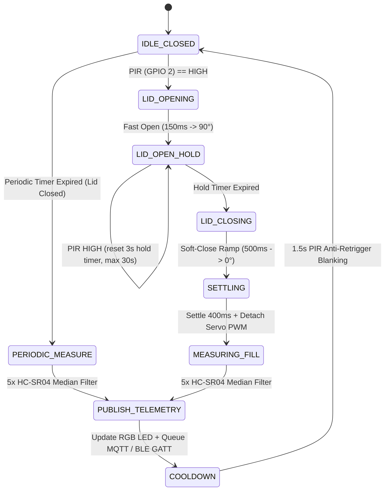

# Functional Specification & Power Management Reference

> [!NOTE]
> Complete functional specification, architecture, and battery power management reference for the **ESP32-S3 Smart Trash Bin + Independent OLED Animation** project on the `YD-ESP32-23` (`ESP32-S3 N16R8`).

---

## 1. Core & Extended Functional Requirements (All Enabled)

### 1.1 Smart Trash Bin Actuation & Sensing
1. **Motion-Triggered Lid Opening (`HC-SR501` on `GPIO 2` $\rightarrow$ `SG90` on `GPIO 21`)**:
   - PIR `HIGH` opens the lid rapidly (~$150\text{ ms}$) to the open angle ($90^\circ$).
   - Holds open while motion continues plus a configurable dwell timeout (default $3\text{ s}$), with a **maximum stuck-sensor timeout** ($30\text{ s}$) in case someone stands stationary beside the bin.
2. **Soft-Close Ramp & Servo PWM Auto-Detach**:
   - Ramps `SG90` smoothly back to the closed angle ($0^\circ$) over ~$500\text{ ms}$ to prevent lid slamming and sensor vibration.
   - Waits $400\text{ ms}$ for mechanical settling, then **detaches PWM (`ledc_stop`)** so the servo draws $0\text{ mA}$ stall current and generates no 5V rail noise while idle.
3. **Post-Close + Periodic Ultrasonic Fill Measurement (`HC-SR04` on `TRIG = GPIO 5`, `ECHO = GPIO 18`)**:
   - **Event-Driven Firing**: Triggered automatically after every lid close + settling delay.
   - **Periodic Firing**: Triggered on a background timer (default every $15\text{ minutes}$, configurable via Kconfig/MQTT) **only when the lid is in `IDLE_CLOSED` state**, detecting trash settling or manual bag changes.
   - **5-Sample Median Filter**: Fires 5 ultrasonic pings ($60\text{ ms}$ apart), discards timeouts, and uses the median distance $d_{\text{cm}}$.
4. **Trash Bin Fill-Level Mapping ($10\text{ cm} = 100\%$, $30\text{ cm} = 0\%$)**:
   $$\text{fill\_pct} = \text{clamp}\!\left(\text{round}\big((30.0 - d_{\text{cm}}) \times 5.0\big),\; 0,\; 100\right)$$
5. **PIR False-Trigger Blanking**:
   - Enforces a $1.5\text{ s}$ software cooldown after servo closure and PWM detach before re-arming PIR interrupts, preventing 5V servo voltage-dip false triggers.
6. **Onboard `WS2812` RGB Status LED (`GPIO 48`)**:
   - **Green**: $< 50\%$ full
   - **Yellow**: $50\%\text{–}85\%$ full
   - **Red (Solid/Pulse)**: $\ge 85\%$ full (triggers `"full_alert": true`)
   - **Blue (Blinking)**: BLE Setup / Wi-Fi Failover active

### 1.2 Connectivity, BLE Failover & MQTT Telemetry
7. **BLE Initial Provisioning & Automatic Wi-Fi Failover (`NimBLE`)**:
   - On first boot (unprovisioned NVS) or whenever Wi-Fi fails after $N$ retries, activates BLE advertising (`SmartBin-S3`).
   - Supports configuring both **Wi-Fi credentials (SSID/Pass)** and **MQTT Broker settings (URI, Port, User, Pass)** over BLE and persisting them in NVS.
   - Exposes a **live BLE GATT Telemetry Service** (`fill_percent`, `distance_cm`, `lid_state`, `battery_mv`) so a phone can read bin status via Bluetooth even when Wi-Fi is down.
   - Periodically retries saved Wi-Fi in the background and automatically disables BLE advertising once Wi-Fi + MQTT reconnects.
8. **MQTT Telemetry, Offline Ring Buffer & Remote Commands**:
   - Publishes JSON telemetry on `smartbin/<id>/telemetry` after every lid cycle and every periodic ultrasonic check.
   - Publishes `"full_alert": true` when `fill_percent >= 95%`.
   - Buffers missed telemetry events in **8 MB Octal PSRAM** (and persists `open_cycles` in NVS) during Wi-Fi outages, flushing automatically upon MQTT reconnect.
   - Subscribes to `smartbin/<id>/cmd` for remote lid open/close, immediate ultrasonic poll, periodic interval adjustment, and $d_{\text{full}}/d_{\text{empty}}$ calibration.

### 1.3 Independent OLED Display ("Chinese Dancing Cat GIF")
9. **Dedicated Core 1 Animation Engine (`SCL = GPIO 7`, `SDA = GPIO 6`)**:
   - Runs in an independent FreeRTOS task pinned to `Core 1`, rendering the $128 \times 64$ monochrome Chinese Dancing Cat GIF at $20\text{–}25\text{ FPS}$ over $400\text{ kHz}$ I2C from PSRAM/Flash frame buffers.
   - Supports an optional **Battery-Saver Auto-Sleep timeout** (keeps playing while motion/activity is present and for $60\text{ s}$ afterward, then sends `SSD1306_DISPLAY_OFF (0xAE)` until next motion wakeup—configurable as Always-On vs. Motion-Awake).

---

## 2. Updated State Machine (Including Periodic Ultrasonic Check & Power Saving)

---

## 3. Battery Power Management & 1000 mAh Runtime Analysis

### 3.1 Component Current Draw Breakdown
| Component | Active Current | Optimized Idle / Sleep Current | Notes |
| :--- | :--- | :--- | :--- |
| **`ESP32-S3 N16R8`** (240 MHz + Octal PSRAM + Active Wi-Fi) | $95\text{–}130\text{ mA}$ | **$14\text{–}18\text{ mA}$** (Modem/Light Sleep) **$0.25\text{ mA}$** (Deep Sleep) | Largest continuous consumer if Wi-Fi power-save is disabled |
| **`YD-ESP32-23` Board Overhead** (LDO + `CH343P` + Power LED) | $5\text{–}8\text{ mA}$ | $3\text{–}6\text{ mA}$ | Onboard USB-UART and LDO quiescent draw when powered via `5V`/`3V3` pin |
| **I2C OLED $128\times 64$** (Playing Dancing Cat GIF) | $12\text{–}18\text{ mA}$ | **$< 0.01\text{ mA}$** (`0xAE` Display Off) | Proportional to lit pixel count (~45% pixels lit in cat animation) |
| **`SG90` Micro Servo** (5V) | $220\text{–}650\text{ mA}$ (moving) | **$0.5\text{–}1.5\text{ mA}$** (PWM detached) $15\text{–}40\text{ mA}$ (if PWM left on!) | Detaching PWM when closed is essential for battery life |
| **`HC-SR04` Ultrasonic** (5V) | $15\text{ mA}$ (during 15 ms ping) | $2.0\text{ mA}$ (continuous) / **$0\text{ mA}$** (MOSFET gated) | Pings take $< 300\text{ ms}$ total per measurement cycle |
| **`HC-SR501` PIR Sensor** | $0.06\text{ mA}$ ($60\text{ }\mu\text{A}$) | **$0.05\text{ mA}$ ($50\text{ }\mu\text{A}$)** | Ultra-low power; can stay powered 24/7 as wakeup source |
| **Onboard `WS2812` RGB LED** | $5\text{–}15\text{ mA}$ (if left bright) | **$\sim 0.8\text{ mA}$** (off/idle quiescent) | Flash briefly for 3s after lid closes instead of keeping lit 24/7 |

---

### 3.2 How Long Will a **1000 mAh** Battery Last?

Assuming a **1000 mAh 3.7V LiPo/Li-ion battery** ($3.7\text{ Wh}$) with a 5V boost converter ($\sim 85\%$ efficiency, so usable capacity referred to the load is $\approx 750\text{–}850\text{ mAh}$ depending on 3.3V/5V split) and **20 trash bin opens per day** + **periodic ultrasonic checks every 15 minutes**:

| Power Profile | How It Works | Average Current (from 1000 mAh cell) | Estimated Runtime on **1000 mAh** |
| :--- | :--- | :--- | :--- |
| **Profile 1: Naive Always-On** *(No power management)* | CPU locked at 240 MHz, Wi-Fi `PS_NONE`, OLED playing dancing cat 24/7, RGB LED on, Servo PWM active. | $\sim 145\text{–}175\text{ mA}$ | **$\approx 5.5 \text{ to } 7 \text{ hours}$** |
| **Profile 2: Smart Active (Wi-Fi Connected 24/7)** *(ESP-IDF DFS + Modem/Light Sleep + OLED Auto-Off)* | Wi-Fi `WIFI_PS_MAX_MODEM` + Automatic Light Sleep (`CONFIG_PM_ENABLE`), CPU scales $240 \leftrightarrow 40\text{ MHz}$, Servo PWM detached when closed, OLED plays dancing cat for $60\text{ s}$ on motion then enters `0xAE` sleep. | $\sim 20\text{–}26\text{ mA}$ | **$\approx 38 \text{ to } 50 \text{ hours}$** *(~1.5 to 2 days)* |
| **Profile 3: Event-Driven Deep Sleep (Software Only)** *(RTC Wakeup on `GPIO 2` PIR + 15-min Timer)* | ESP32-S3 sleeps between events; wakes instantly on `GPIO 2` (`RTC_GPIO2`) motion to open lid + play OLED dancing cat + measure & send MQTT, or wakes on timer for periodic ultrasonic check. | $\sim 5.5\text{–}7.5\text{ mA}$ *(limited by board LDO + `HC-SR04` idle draw)* | **$\approx 5.5 \text{ to } 7.5 \text{ days}$** |
| **Profile 4: Deep Sleep + 5V Peripheral Power Gating** *(Profile 3 + High-Side MOSFET for 5V rail)* | Same as Profile 3, plus a GPIO-controlled MOSFET switches off the 5V boost rail (`SG90` + `HC-SR04`) during sleep, leaving only `HC-SR501` ($50\text{ }\mu\text{A}$) active. | $\sim 1.8\text{–}3.0\text{ mA}$ | **$\approx 14 \text{ to } 22 \text{ days}$** |

---

### 3.3 Concrete Firmware & Hardware Power Management Recommendations

#### A. Firmware Power Management (Zero Extra Hardware Required)
1. **Enable ESP-IDF Power Management (`esp_pm`) & Tickless Idle**:
   - Set `CONFIG_PM_ENABLE=y` and `CONFIG_FREERTOS_USE_TICKLESS_IDLE=y`.
   - Configure `esp_pm_config_t` with `max_freq_mhz = 240`, `min_freq_mhz = 40`, `light_sleep_enable = true`.
2. **Enable Wi-Fi Max Modem Sleep (`WIFI_PS_MAX_MODEM`)**:
   - Call `esp_wifi_set_ps(WIFI_PS_MAX_MODEM)` after connecting. This alone cuts ESP32-S3 idle current by **$> 75\text{ mA}$** while keeping MQTT connected!
3. **Motion-Woken OLED Display Timeout (`SSD1306 0xAE`)**:
   - Run the Chinese Dancing Cat GIF whenever PIR (`GPIO 2`) detects motion and keep it playing for a configurable window (e.g. $60\text{ s}$ after last motion), then issue `0xAE` (`DISPLAY_OFF`) to drop OLED draw from $15\text{ mA}$ to $< 10\text{ }\mu\text{A}$.
4. **Servo PWM Auto-Detach + Brief Status LED Pulse**:
   - Call `ledc_stop()` $500\text{ ms}$ after lid closes.
   - Show the fill-level color on the `GPIO 48` WS2812 LED for $5\text{ s}$ after lid closes, then turn it off (`0, 0, 0`) to save $10\text{–}15\text{ mA}$.
5. **Configurable Operating Mode (`ALWAYS_ONLINE` vs. `DEEP_SLEEP_BATTERY`)**:
   - Because `GPIO 2` is **`RTC_GPIO2`**, the firmware can support a Kconfig/MQTT-selectable **Deep Sleep Battery Mode** using `esp_sleep_enable_ext0_wakeup(GPIO_NUM_2, 1)` (PIR wakeup) combined with `esp_sleep_enable_timer_wakeup(periodic_us)` (periodic ultrasonic check).

#### B. Hardware Battery Wiring Recommendations
1. **Separate 3.3V and 5V Regulation with Bulk Capacitor**:
   - Power `ESP32-S3 (3V3)` + `OLED` + `HC-SR501` (via its 3.3V bypass pin) from a high-efficiency **3.3V buck-boost regulator** (e.g., `TPS63020` / `S7V8F3`), instead of boosting 3.7V $\to$ 5V and burning it back down to 3.3V through the board's inefficient linear AMS1117 LDO.
   - Use a **5V boost converter with an `EN` (Enable) pin** (e.g., `MT3608` / `FP6291` / load switch) exclusively for `SG90` and `HC-SR04`. Tie its `EN` pin to a spare ESP32-S3 GPIO (e.g., `GPIO 4`) so the 5V rail is **100% powered off ($0\text{ }\mu\text{A}$)** when the lid is closed and not measuring!
   - Place a **$470\text{ }\mu\text{F}\text{–}1000\text{ }\mu\text{F}$ electrolytic capacitor** across the 5V servo power pins to absorb `SG90` startup current spikes ($> 500\text{ mA}$) so a small 1000 mAh battery doesn't sag and reset the MCU.
2. **Swap `HC-SR04` (5V) for `HC-SR04P` / `RCWL-1601` (3.3V)**:
   - The `HC-SR04P` is a drop-in 3.3V ultrasonic replacement that eliminates the need for 5V on the ultrasonic sensor and removes the need for a voltage divider on `ECHO (GPIO 18)`.
