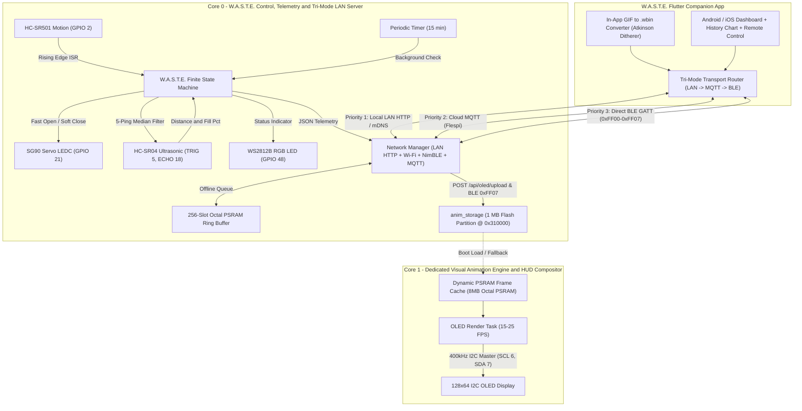

<div align="center">

# W.A.S.T.E.
### **W**aste **A**utomation and **S**ensing **T**echnology **E**ngine

*Next-Generation Dual-Core IoT Smart Receptacle Firmware & Flutter Companion Ecosystem for ESP32-S3 (`N16R8`)*

[](https://github.com/ASCENDINGHeat/waste-trash-bin/releases/tag/v2.0.0)
[](https://github.com/espressif/esp-idf)
[](./docs/01-hardware-and-pinout.md)
[](./docs/06-flutter-companion-app.md)
[](https://github.com/ASCENDINGHeat/waste-trash-bin/actions/workflows/build.yml)
[](https://github.com/ASCENDINGHeat/waste-trash-bin/actions/workflows/build-app.yml)

</div>

---

## Overview

**W.A.S.T.E.** (**Waste Automation and Sensing Technology Engine**) is an industrial-grade, dual-core embedded firmware and mobile companion platform built on **ESP-IDF `v6.1`** for the **`YD-ESP32-23` (`ESP32-S3-WROOM-1-N16R8`)**.

Designed from the ground up to eliminate common failure modes of consumer "smart" bins—such as lid-slamming, power-rail false re-triggering, acoustic echo spikes, and offline data loss—**W.A.S.T.E. v2.0.0** introduces **Tri-Mode Connectivity** (Local LAN HTTP/mDNS + Cloud MQTT + BLE GATT failover), a user-uploadable **Custom `.wbin` OLED Animation Subsystem** backed by a dedicated 1 MB flash partition and 8 MB Octal PSRAM caching with live OLED upload progress feedback, and an in-app **GIF-to-`.wbin` Converter** with Atkinson dithering inside the cross-platform **Flutter Companion App**.

---

## Key Capabilities

### 1. Touchless Kinematics & Anti-Slam Servo Control
- **Instant Motion Response (`150 ms`)**: `HC-SR501` PIR sensing on `GPIO 2` (`RTC_GPIO2`) triggers immediate lid opening via 14-bit `50 Hz` LEDC PWM (`GPIO 21`).
- **Soft-Close Ramping (`500 ms`)**: Smoothly interpolates `SG90` closing trajectory to prevent mechanical lid slam and sensor vibration.
- **Zero-Hum PWM Auto-Detach**: Automatically halts PWM pulses (`ledc_stop`) `400 ms` after closure—eliminating idle stall current ($15\text{–}40\text{ mA} \rightarrow 0\text{ mA}$), servo heating, and 5V rail noise.
- **PIR Anti-Retrigger Blanking (`1.5 s`)**: Hardware/software blanking window prevents 5V servo transients from causing endless open–close ghost loops.

### 2. Precision Ultrasonic Fill-Level Analytics
- **Post-Close + Periodic Sensing**: Automatically fires the `HC-SR04` (`TRIG = GPIO 5`, `ECHO = GPIO 18`) after every lid closure **and** on a configurable background schedule (default every `15 minutes` while closed) to detect trash settling.
- **5-Ping Median Filtering**: Rejects multipath acoustic bounces inside crinkled bin liners by sorting 5 rapid ultrasonic samples and extracting the true median distance.
- **Calibrated Fill Mapping**: Linearly maps bin depth from **$30\text{ cm}$ ($0\%$ Empty)** to **$10\text{ cm}$ ($100\%$ Full)** with runtime-configurable thresholds over LAN HTTP, MQTT, or BLE.
- **Onboard `WS2812B` RGB Status (`GPIO 48`)**: Visual fill-level feedback (**Green** $< 50\%$, **Amber** $50\text{–}84\%$, **Red** $\ge 85\%$, **Blue** = BLE Setup/Failover) with a 5-second battery-saver auto-off timer.

### 3. Self-Healing Tri-Mode Connectivity: LAN + MQTT + NimBLE Failover
- **Priority 1 — Embedded Local LAN HTTP & mDNS (`esp_http_server`)**: Sub-10ms response on port 80 with mDNS advertisement (`_waste._tcp` / `smartbin_s3_<mac>`). Exposes REST endpoints for telemetry (`GET /api/status`), custom animation streaming (`POST /api/oled/upload`), mascot reset (`POST /api/oled/reset`), lid actuation (`POST /api/lid`), manual ultrasonic ping (`POST /api/measure`), and runtime threshold updates (`POST /api/config`).
- **Priority 2 — Real-Time Cloud MQTT (`esp-mqtt`)**: Publishes structured JSON telemetry (`smartbin/<id>/telemetry`), retained full-bin alerts (`smartbin/<id>/alert`), and Last Will & Testament state (`smartbin/<id>/status`), with built-in support for **Flespi (`mqtt.flespi.io`)**, EMQX, and Mosquitto. Extends remote commands with `"fetch_anim"` (background HTTP client download) and `"reset_anim"`.
- **256-Event Octal PSRAM Ring Buffer**: Never loses a telemetry event during Wi-Fi outages—records are buffered in **8 MB Octal PSRAM** (and lifetime `open_cycles` persisted in Flash NVS) and flushed chronologically the instant MQTT reconnects.
- **Priority 3 — Direct BLE GATT Provisioning & Failover (`NimBLE`)**: Advertises custom BLE GATT service (`0xFF00`–`0xFF07`) on first boot, whenever Wi-Fi drops, or when the onboard **`BOOT` (`GPIO 0`)** button is pressed. Characteristic `0xFF07` supports 244-byte chunked `.wbin` animation streaming with real-time OLED upload progress HUD display.

### 4. Dedicated `Core 1` OLED HUD & Custom `.wbin` Animation Engine
- **100% Decoupled Visual Pipeline**: Pinned exclusively to **Xtensa LX7 `Core 1`**, rendering a context-aware Smart HUD ($128 \times 64$, `SCL = GPIO 6`, `SDA = GPIO 7` @ `400 kHz` I2C) composited over animated frames directly from **8 MB Octal PSRAM** with zero frame drops during network or sensor operations.
- **1 MB Dedicated Animation Partition (`anim_data`)**: Aligned 1 MB Flash partition (`subtype 0x99 @ 0x310000`) stores custom `.wbin` (`WGF1`) animations (up to 512 frames, 5–30 FPS). Validates magic, bounds, and IEEE 802.3 CRC32 before flash commit.
- **Dynamic PSRAM Caching & Instant Mascot Fallback**: Dynamically loads `.wbin` frames into 8 MB Octal PSRAM at boot. In the event of empty flash, CRC mismatch, or user reset, seamlessly falls back to the pre-rendered 85-frame Hololive Risu / Dancing Cat mascot (`dancing_cat_frames.h`).
- **Live Upload Progress HUD**: Visual overlay bar (`"UPLOADING GIF: XX%"`) with transport badge (`LAN`, `BLE`, or `MQTT`) rendered live on Core 1 during animation transfers.

### 5. Cross-Platform Flutter Companion App (`companion_app/`)
- **Tri-Mode Automatic Transport Router**: Connects via Local LAN first, falling back to Cloud MQTT and BLE GATT `0xFF00`.
- **In-App GIF to `.wbin` Converter (`WbinEncoder`)**: Mobile-side conversion pipeline with box downsampling, Atkinson 1-bit error-diffusion dithering, virtual 128x64 OLED canvas preview (`OledCanvasPainter`), and IEEE 802.3 CRC32 container packing.
- **Animation Upload Sheet & Mascot Reset**: Modal UI with GIF picker, frame scrub slider, FPS control, live upload progress bar, and 1-tap "Reset to Mascot" action.
- **Zero-Touch Provisioning & Remote Control**: Scan & provision Wi-Fi/Flespi MQTT credentials over BLE, remotely open the lid (`open_lid`), trigger instant ultrasonic pings (`measure_now`), calibrate bin depth ($10\text{–}30\text{ cm}$), and view historical fill-level trend charts stored locally on the phone.

---

## Dual-Core System Architecture



---

## Hardware & Pinout Summary (`YD-ESP32-23` / `ESP32-S3 N16R8`)

| Subsystem | Component | Signal | ESP32-S3 Pin | Notes |
| :--- | :--- | :--- | :--- | :--- |
| **Motion Sensor** | `HC-SR501` PIR | `OUT` | **`GPIO 2`** (`RTC_GPIO2`) | 3.3V HIGH on motion; supports `ext0` Deep Sleep wakeup |
| **Distance Sensor** | `HC-SR04` Ultrasonic | `TRIG` | **`GPIO 5`** | $10\text{ }\mu\text{s}$ trigger pulse output |
| **Distance Sensor** | `HC-SR04` Ultrasonic | `ECHO` | **`GPIO 18`** | Pulse-width input ($10\text{ cm} = 100\%$, $30\text{ cm} = 0\%$) |
| **Lid Actuator** | `SG90` Micro Servo | `PWM` | **`GPIO 21`** | 50 Hz 14-bit LEDC PWM with auto-detach |
| **OLED Display** | $128 \times 64$ I2C OLED | `SCL` | **`GPIO 6`** | 400 kHz `esp_driver_i2c` Master Clock |
| **OLED Display** | $128 \times 64$ I2C OLED | `SDA` | **`GPIO 7`** | 400 kHz `esp_driver_i2c` Master Data |
| **Status LED** | Onboard `WS2812B` | `DIN` | **`GPIO 48`** | RMT `espressif/led_strip` (bridge `RGB` pad on board) |
| **Provision Button** | Onboard `BOOT` Key | `BTN` | **`GPIO 0`** | Short press = Enable BLE; 3s hold = Reset Wi-Fi NVS |
| **5V Power Gate** | Boost `EN` / MOSFET | `EN` | **`GPIO 4`** *(optional)* | Cuts 5V idle draw during Deep Sleep |

---

## Quick Start & Installation (`v2.0.0` Release)

### Option 1 — Download Pre-Built Firmware & Android APK from [GitHub Releases (`v2.0.0`)](https://github.com/ASCENDINGHeat/waste-trash-bin/releases/tag/v2.0.0)
1. Download **`waste-firmware-v2.0.0-merged.bin`** and **`waste-companion-v2.0.0.apk`** from the **[Releases Page](https://github.com/ASCENDINGHeat/waste-trash-bin/releases/latest)** (or from the latest **[GitHub Actions run](https://github.com/ASCENDINGHeat/waste-trash-bin/actions)**).
2. Install **`waste-companion-v2.0.0.apk`** on your Android device.
3. Flash **`waste-firmware-v2.0.0-merged.bin`** to your `YD-ESP32-23` (`ESP32-S3`) at address **`0x0`** using:
   - **Browser**: [Espressif ESPTool-JS Web Flasher](https://espressif.github.io/esptool-js/)
   - **Android (USB-C OTG)**: **ZFlasher AVR/ESP** or **ESPLoader** (`ESP32-S3`, offset `0x0`)
   - **CLI (`esptool.py`)**:
     ```bash
     esptool.py --chip esp32s3 --port /dev/ttyACM0 --baud 460800 write_flash 0x0 waste-firmware-v2.0.0-merged.bin
     ```

### Option 2 — Build Firmware & Companion App Locally
```bash
# 1. Build & flash ESP32-S3 firmware (ESP-IDF v6.1):
idf.py set-target esp32s3
idf.py build
idf.py -p /dev/ttyACM0 flash monitor

# 2. Build & test W.A.S.T.E. Flutter Companion APK:
cd companion_app
flutter pub get
flutter test
flutter build apk --release
```

### Custom OLED Animations (`.wbin`)
- **Direct In-App Conversion (Recommended)**: Open the Flutter Companion App, tap the OLED filmstrip icon in the AppBar, pick any `.gif` from your phone, preview the 128x64 Atkinson monochrome rendering, and tap Upload over LAN HTTP or BLE `0xFF07` in seconds!
- **CLI Converters** (for compiling directly into firmware headers):
  ```bash
  # Node.js converter (Atkinson 1-bit dithering, 128x64 SSD1306 page format):
  node tools/gif_to_oled.mjs path/to/animation.gif main/dancing_cat_frames.h

  # Or Python Pillow converter:
  python3 tools/gif_to_oled.py path/to/animation.gif -o main/dancing_cat_frames.h --dither
  ```

---

## Complete Documentation (`docs/`)

All engineering specifications, state machines, protocols, and power analyses are organized in [`docs/`](./docs/README.md):

| Document | Topic |
| :--- | :--- |
| **[docs/README.md](./docs/README.md)** | Master Documentation Index & Quick Reference |
| **[docs/01-hardware-and-pinout.md](./docs/01-hardware-and-pinout.md)** | `YD-ESP32-23` (`N16R8`) Architecture, Solder Jumpers, Reserved Octal PSRAM Pins & Wiring |
| **[docs/02-functional-specification.md](./docs/02-functional-specification.md)** | Dual-Core Partitioning, W.A.S.T.E. State Machine, Ultrasonic Math & `Core 1` OLED Engine |
| **[docs/03-connectivity-ble-and-mqtt.md](./docs/03-connectivity-ble-and-mqtt.md)** | Tri-Mode Architecture (LAN HTTP/mDNS + MQTT + BLE `0xFF00`–`0xFF07`), Provisioning, Flespi & Remote Commands |
| **[docs/04-power-management-and-battery.md](./docs/04-power-management-and-battery.md)** | 1000 mAh Battery Runtime Analysis ($5.5\text{ hrs} \rightarrow 22\text{ days}$), Sleep Modes & Flash Endurance |
| **[docs/05-esp-idf-v6.1-guide.md](./docs/05-esp-idf-v6.1-guide.md)** | ESP-IDF `v6.1` Modular Drivers, Managed Components, Component Registrations, CI/CD & Flashing Guide |
| **[docs/06-flutter-companion-app.md](./docs/06-flutter-companion-app.md)** | Flutter Companion App Architecture, Tri-Mode Routing, In-App GIF to `.wbin` Converter, Unit Tests & APK Build |
| **[docs/07-smart-oled-hud-and-ui.md](./docs/07-smart-oled-hud-and-ui.md)** | Core 1 Smart OLED HUD, 1 MB `anim_data` Flash Map, `.wbin` Custom Animation Engine, PSRAM Caching & Live Progress HUD |
| **[docs/08-feature-status-and-gap-analysis.md](./docs/08-feature-status-and-gap-analysis.md)** | Feature Tracking Matrix & Gap Analysis (Gap B Implemented for v2.0.0, Zero Pending Gaps) |
| **[CHANGELOG.md](./CHANGELOG.md)** | Release History (`v2.0.0`, `v1.1.0` & `v1.0.0` Release Notes) |
