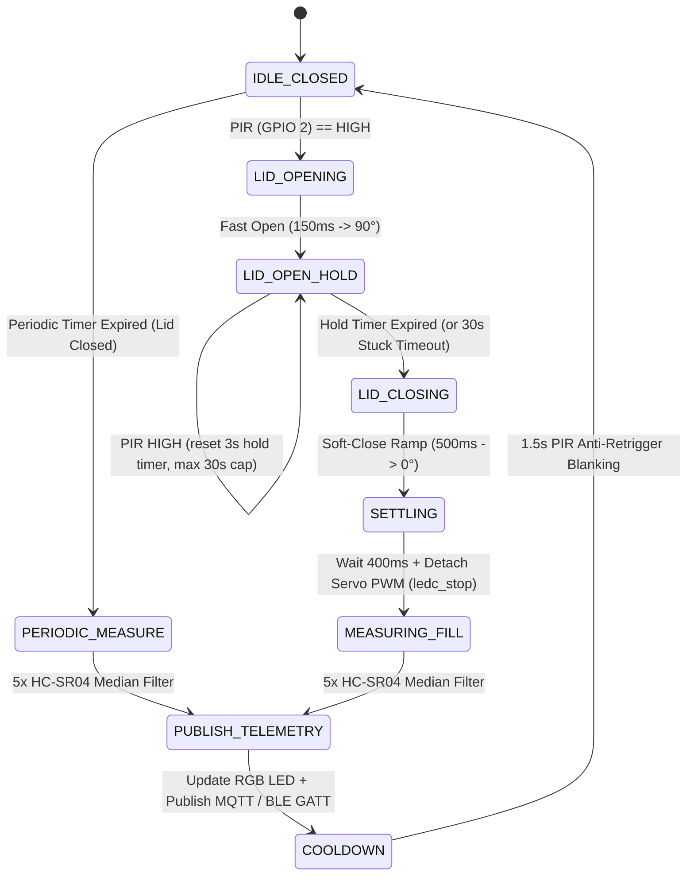

# 02 — Functional Specification & Subsystem Design

## 1. Dual-Core Task Architecture (`ESP32-S3`)

To guarantee that the **Chinese Dancing Cat GIF** on the OLED never drops frames during Wi-Fi connection retries, BLE advertising, servo ramping, or ultrasonic pulse measurement, the workload is partitioned across the two Xtensa LX7 cores:

```mermaid
flowchart TD
    subgraph Core0["Core 0: Smart Trash Bin FSM & Wireless Stack"]
        PIR["HC-SR501 PIR (GPIO 2)"] -->|ISR / Event Queue| FSM["Trash Bin FSM Task"]
        TIMER["Periodic Check Timer (15m)"] -->|Timer Event| FSM
        FSM -->|Fast Open / Soft Close + Auto-Detach| SERVO["SG90 Servo LEDC (GPIO 21)"]
        FSM -->|5-Ping Median Filter| ULTRA["HC-SR04 Ultrasonic (TRIG: 5, ECHO: 18)"]
        ULTRA -->|Distance cm & Fill %| FSM
        FSM -->|Status Color| RGB["WS2812 RGB LED (GPIO 48)"]
        FSM -->|Telemetry Event| NET["Wi-Fi / MQTT / BLE Manager"]
    end

    subgraph Core1["Core 1: Independent OLED Animation Engine"]
        PSRAM["Dancing Cat Frames (Flash -> 8MB Octal PSRAM)"] --> OLED_TASK["OLED Render Task (20-25 FPS)"]
        OLED_TASK -->|400kHz I2C Master (SDA: 6, SCL: 7)| OLED["128x64 I2C OLED Display"]
    end
```

---

## 2. Smart Trash Bin Finite State Machine (FSM)



### 2.1 Step-by-Step Operational Rules
1. **Motion Trigger (`IDLE_CLOSED -> LID_OPENING`)**:
   - When `GPIO 2` (`HC-SR501` `OUT`) transitions `HIGH`, the FSM immediately enables the `SG90` PWM channel (`GPIO 21`) and moves the servo to the **Open Angle** ($90^\circ$, configurable $60^\circ\text{–}120^\circ$) in $\sim 150\text{ ms}$.
2. **Dwell / Hold Open (`LID_OPEN_HOLD`)**:
   - Remains open for $3.0\text{ seconds}$ after the last detected motion.
   - If motion persists (`GPIO 2` stays `HIGH`), the $3.0\text{ s}$ hold timer resets continuously up to a **maximum stuck-sensor safety cap of $30\text{ seconds}$**.
3. **Soft-Close Ramp (`LID_CLOSING`)**:
   - Instead of snapping abruptly to $0^\circ$ (which slams the lid and vibrates the ultrasonic sensor), the servo angle is interpolated smoothly from $90^\circ \to 0^\circ$ over $500\text{ ms}$ ($20\text{ ms}$ steps).
4. **Mechanical Settling & PWM Auto-Detach (`SETTLING`)**:
   - Once at $0^\circ$, waits $400\text{ ms}$ so the lid comes to a complete rest, then calls `ledc_stop()` to **detach PWM pulses**, eliminating servo idle hum, overheating, and 5V rail noise.
5. **Post-Close Ultrasonic Measurement (`MEASURING_FILL`)**:
   - Triggered automatically by the completion of the `SG90` return-to-normal sequence.
   - Fires **5 ultrasonic pings** ($60\text{ ms}$ apart) on `TRIG (GPIO 5)` and measures pulse width $\Delta t_{\mu\text{s}}$ on `ECHO (GPIO 18)` (with a $25\text{ ms}$ timeout per ping).
   - Sorts the valid samples and selects the **median** distance $d_{\text{cm}}$.
6. **Periodic Ultrasonic Firing (`PERIODIC_MEASURE`)**:
   - A periodic timer (default every **$15\text{ minutes}$**, configurable) triggers the exact same 5-sample median ultrasonic measurement **only if the FSM is currently in `IDLE_CLOSED`**.
   - If the lid is open when the periodic timer expires, the periodic check is skipped because the post-close measurement will run as soon as the lid closes.
7. **PIR Anti-Retrigger Blanking (`COOLDOWN`)**:
   - Ignores PIR edges for $1.5\text{ seconds}$ after closing and measuring to guarantee power-rail recovery cannot cause a false re-open loop.

---

## 3. Fill-Level Formula & Alert Thresholds

Given trash bin calibration distances:
- **Full ($100\%$)**: $d_{\text{full}} = 10.0\text{ cm}$
- **Empty ($0\%$)**: $d_{\text{empty}} = 30.0\text{ cm}$

### 3.1 Distance Calculation
$$d_{\text{cm}} = \frac{\Delta t_{\mu\text{s}} \times 0.0343}{2} \approx \frac{\Delta t_{\mu\text{s}}}{58.0}$$

### 3.2 Fill Percentage Mapping
$$\text{fill\_percent} = \begin{cases} 100 & \text{if } d_{\text{cm}} \le 10.0 \\ 0 & \text{if } d_{\text{cm}} \ge 30.0 \\ \text{round}\!\left(\frac{30.0 - d_{\text{cm}}}{30.0 - 10.0} \times 100.0\right) = \text{round}\!\left((30.0 - d_{\text{cm}}) \times 5.0\right) & \text{if } 10.0 < d_{\text{cm}} < 30.0 \end{cases}$$

### 3.3 Onboard `WS2812B` RGB LED (`GPIO 48`) Status Mapping
| Condition | RGB Color | Behavior |
| :--- | :--- | :--- |
| `fill_percent < 50%` | **Green** (`#00FF00`) | Lit for $5\text{ s}$ after lid close (or continuous on USB power) |
| `50% <= fill_percent < 85%` | **Yellow/Amber** (`#FFAA00`) | Lit for $5\text{ s}$ after lid close |
| `fill_percent >= 85%` | **Red** (`#FF0000`) | Pulses red + sets `"full_alert": true` in telemetry (`>= 95%`) |
| BLE Setup / Wi-Fi Failover | **Blue** (`#0066FF`) | Blinking $2\text{ Hz}$ while BLE advertising is active |

---

## 4. Independent OLED Display Engine ("Chinese Dancing Cat GIF")

- **Complete Functional Isolation**:
  - The OLED display (`SCL = GPIO 7`, `SDA = GPIO 6`) does **not** display trash bin text or wait on sensor locks. Its sole job is to render the **Chinese Dancing Cat GIF** animation smoothly.
- **Memory & Rendering Pipeline**:
  - Each $128 \times 64$ monochrome frame occupies $128 \times 64 / 8 = 1024\text{ bytes}$ ($1\text{ KB}$) in SSD1306 page-addressed format ($8\text{ pages} \times 128\text{ columns}$).
  - With **16 MB Flash** and **8 MB Octal PSRAM**, the complete multi-frame animation array is copied into an Octal PSRAM buffer (`heap_caps_malloc(..., MALLOC_CAP_SPIRAM)`) at boot.
  - The `oled_anim_task` on **Core 1** loops through the frames at a steady $20\text{–}25\text{ FPS}$ ($40\text{–}50\text{ ms}$ per frame using `vTaskDelayUntil`) over $400\text{ kHz}$ I2C (`esp_driver_i2c`).
- **Battery-Saver Display Sleep Option**:
  - Configurable via Kconfig/MQTT (`OLED_ALWAYS_ON` vs `OLED_MOTION_WAKE`):
    - `OLED_ALWAYS_ON`: Plays the dancing cat 24/7 (ideal for USB power).
    - `OLED_MOTION_WAKE`: Plays the dancing cat while motion is detected + $60\text{ seconds}$ afterward, then sends command `0xAE` (`SSD1306_DISPLAY_OFF`, $< 10\text{ }\mu\text{A}$) until the next motion trigger.
