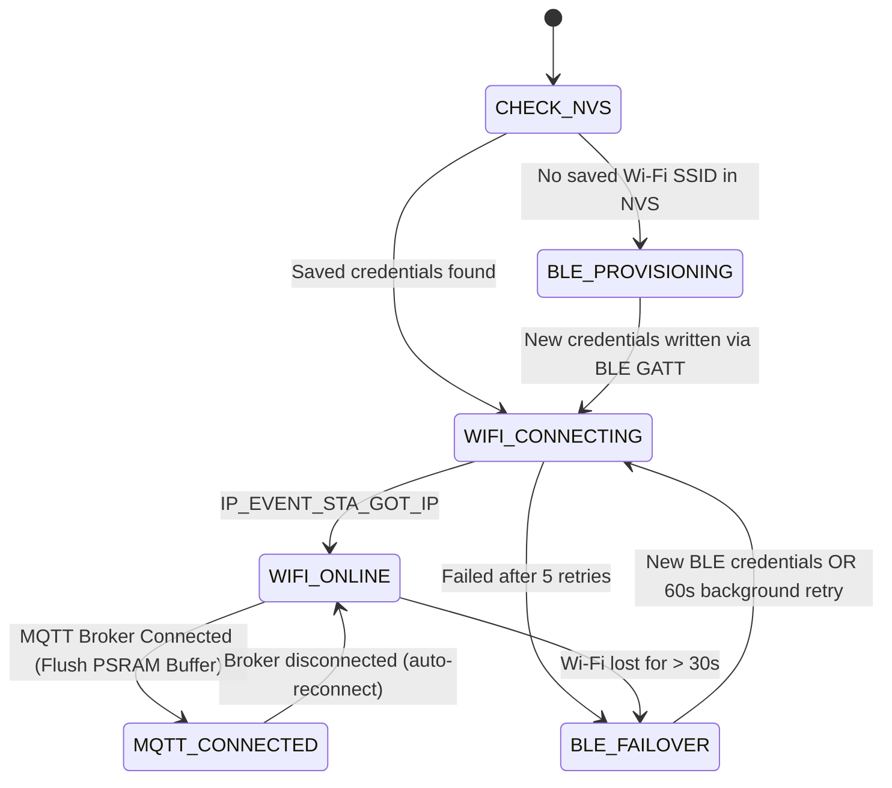
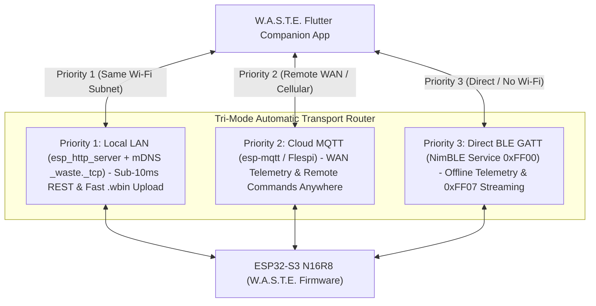

# 03 — W.A.S.T.E. Connectivity: BLE Setup/Failover & MQTT Protocol

## 1. Network Lifecycle & Automatic BLE Failover

**W.A.S.T.E.** (**Waste Automation and Sensing Technology Engine**) uses a unified **Network Manager** that coordinates **Wi-Fi STA**, **NimBLE (Bluetooth Low Energy)**, and **MQTT (`esp-mqtt`)**:



---

## 2. Bluetooth Low Energy (`NimBLE`) Specification

### 2.1 Why `NimBLE` on ESP-IDF `^6.1`
- Uses $< 50\%$ of the RAM required by Bluedroid and integrates cleanly with ESP32-S3 Octal PSRAM (`CONFIG_BT_NIMBLE_ENABLED=y`).
- Active in two scenarios:
  1. **Initial Setup**: First boot when NVS (`net_cfg` namespace) has no Wi-Fi credentials.
  2. **Wi-Fi Failover**: Automatically starts advertising (`SmartBin-S3-XXXX`) whenever Wi-Fi fails to connect after 5 attempts or stays disconnected for $> 30\text{ seconds}$.

### 2.2 BLE GATT Custom Service (`UUID: 0xFF00` / 128-bit UUID)
Provides both **Configuration (Provisioning)** and **Live Offline Telemetry**:

| Characteristic | UUID Offset | Properties | Format / Purpose |
| :--- | :--- | :--- | :--- |
| **Wi-Fi SSID** | `0xFF01` | `Read`, `Write` | UTF-8 string (max 32 bytes) — stored in NVS |
| **Wi-Fi Password** | `0xFF02` | `Write` | UTF-8 string (max 64 bytes) — stored in NVS |
| **MQTT Broker URI** | `0xFF03` | `Read`, `Write` | UTF-8 string (e.g. `mqtt://192.168.1.10:1883`) — stored in NVS |
| **Apply & Connect** | `0xFF04` | `Write` | Write `0x01` to save to NVS and trigger immediate Wi-Fi connection attempt |
| **Live Bin Telemetry** | `0xFF05` | `Read`, `Notify` | JSON (`fill_percent`, `distance_cm`, `lid_state`, `open_cycles`) so the user's phone can monitor the trash bin over BLE even when Wi-Fi is down! |
| **Remote Command JSON** | `0xFF06` | `Write` | Accepts the same JSON command payloads as `smartbin/<id>/cmd` (`open_lid`, `measure_now`, `configure`) directly over BLE! |
| **Custom Animation Stream** | `0xFF07` | `Write`, `Write Without Response` | Raw 244-byte chunked `.wbin` animation stream with live OLED upload progress HUD display and IEEE 802.3 CRC32 verification |

---

## 3. MQTT Telemetry Protocol (`esp-mqtt`)

### 3.1 Topic Hierarchy
Using `<device_id>` derived from the ESP32-S3 factory MAC address (e.g., `smartbin_s3_a1b2c3`):

| Topic | Direction | QoS | Retain | Description |
| :--- | :--- | :--- | :--- | :--- |
| `smartbin/<device_id>/telemetry` | Publish | `1` | `false` | Published after every lid close measurement and every periodic ultrasonic check |
| `smartbin/<device_id>/alert` | Publish | `1` | `true` | Published when `fill_percent >= 95%` (cleared when emptied `< 20%`) |
| `smartbin/<device_id>/status` | Publish / LWT | `1` | `true` | `"online"` on connect; Last Will & Testament (LWT) `"offline"` on unexpected drop |
| `smartbin/<device_id>/cmd` | Subscribe | `1` | `false` | Remote JSON commands (open lid, measure now, calibrate, set periodic interval) |

### 3.2 Telemetry JSON Payload (`smartbin/<device_id>/telemetry`)
Built using the `espressif/cjson` managed component:
```json
{
  "device_id": "smartbin_s3_a1b2c3",
  "trigger": "lid_close",
  "fill_percent": 75,
  "distance_cm": 15.0,
  "full_alert": false,
  "lid_state": "closed",
  "open_cycles": 42,
  "wifi_rssi": -58,
  "uptime_s": 3600
}
```
- `"trigger"` values: `"lid_close"`, `"periodic"`, `"remote_cmd"`, or `"boot"`.

### 3.3 Remote Command JSON Payloads (`smartbin/<device_id>/cmd`)
- **Trigger immediate ultrasonic measurement**:
  ```json
  {"cmd": "measure_now"}
  ```
- **Remote lid open**:
  ```json
  {"cmd": "open_lid", "hold_s": 5}
  ```
- **Download and flash custom `.wbin` animation from URL**:
  ```json
  {"cmd": "fetch_anim", "url": "http://192.168.1.50:8000/custom_animation.wbin"}
  ```
- **Reset custom animation back to default mascot**:
  ```json
  {"cmd": "reset_anim"}
  ```
- **Update calibration thresholds, periodic interval, and OLED HUD style (persisted to NVS)**:
  ```json
  {
    "cmd": "configure",
    "full_cm": 10.0,
    "empty_cm": 30.0,
    "periodic_interval_s": 900,
    "oled_sleep_timeout_s": 60,
    "oled_ui_mode": "hud_mascot"
  }
  ```

---

## 4. Offline Telemetry Ring Buffer (PSRAM)
- When Wi-Fi or the MQTT broker is unreachable during a lid-close event or periodic check:
  1. `open_cycles` is incremented and committed to `NVS` (`nvs_flash`).
  2. Up to **256 telemetry records** are queued in a ring buffer allocated in the **8 MB Octal PSRAM**.
  3. As soon as `MQTT_EVENT_CONNECTED` fires, queued records are published in chronological order before normal operation resumes.


---

## 5. Connecting to Flespi MQTT Broker (`mqtt.flespi.io`)

**Flespi** provides a fast, free cloud MQTT 3.1.1 / 5.0 broker (`mqtt.flespi.io`) with a built-in web MQTT Board for inspecting topics in real time.

### Step 1 — Get Your Flespi Token
1. Sign in at **[flespi.io](https://flespi.io/)** (GitHub / Google login supported).
2. In the left sidebar, go to **Access Control → Tokens**.
3. Copy your **Master Token** (or click **`+`** to create a Standard Token).
   - It is a 64-character string (e.g., `a1B2c3D4e5F6...`).
   - Do **not** include the `FlespiToken ` prefix when embedding it in an `mqtt://` URI (or if you paste it into the W.A.S.T.E. Companion App's **Flespi Token** box, the app automatically strips any `FlespiToken ` prefix for you).

### Step 2 — Format the Flespi Broker URI
Flespi authenticates using your token as the **MQTT Username** (with an empty password). Both the **ESP32-S3 (`esp-mqtt`)** and the **W.A.S.T.E. Flutter Companion App** natively support embedding the token directly in the URI:

```text
mqtt://<YOUR_FLESPI_TOKEN>@mqtt.flespi.io:1883
```

### Step 3 — Provision the ESP32-S3 & Connect the Companion App

#### Option A: Via the W.A.S.T.E. Flutter Companion App (No Re-flashing Needed)
1. Power on the `YD-ESP32-23` (`ESP32-S3`). If Wi-Fi is not yet configured, the onboard RGB LED (`GPIO 48`) glows **Blue** and advertises **`smartbin_s3_xxxxxx`** over BLE.
2. Open the **W.A.S.T.E. Companion App** and tap the **Antenna icon (`Connectivity & BLE Provisioning`)** in the top-right corner.
3. Under **1. MQTT Broker**:
   - Tap **`Flespi Preset`** (sets `mqtt://mqtt.flespi.io:1883`).
   - Paste your 64-character token into **`Flespi Token / MQTT Username`**.
   - Tap **`Connect MQTT`** — the phone app automatically builds `mqtt://<TOKEN>@mqtt.flespi.io:1883` and connects using MQTT 3.1.1.
4. Under **2. Direct BLE GATT (`0xFF00`)**:
   - Tap **`Scan BLE`** and tap **`Connect`** next to `smartbin_s3_xxxxxx`.
5. Under **3. Provision ESP32-S3 NVS over BLE**:
   - Enter your **2.4 GHz Wi-Fi SSID** and **Password**.
   - Tap **`Write to ESP32-S3 NVS & Connect Wi-Fi`** — this writes your Wi-Fi credentials (`0xFF01`/`0xFF02`) and the full Flespi token URI (`0xFF03`) into the ESP32-S3's NVS flash and triggers immediate connection (`0xFF04`).

#### Option B: Compile Default into Firmware (`idf.py menuconfig`)
If building locally, you can also set the default broker URI in **`Kconfig.projbuild`**:
```text
idf.py menuconfig
  -> W.A.S.T.E. Smart Trash Bin Configuration (ESP32-S3 N16R8)
  -> Default MQTT Broker URI: mqtt://<YOUR_FLESPI_TOKEN>@mqtt.flespi.io:1883
```

### Step 4 — Verify Live Telemetry in Flespi's Web Dashboard
1. In your browser, open **[MQTT Board (flespi.io)](https://flespi.io/mqtt-board)** (or click **MQTT → MQTT Board** inside the Flespi panel).
2. Add a **Subscriber** with topic filter:
   ```text
   smartbin/#
   ```
3. You will immediately see:
   - `smartbin/smartbin_s3_xxxxxx/status` $\rightarrow$ `"online"` (retained)
   - `smartbin/smartbin_s3_xxxxxx/telemetry` $\rightarrow$ Live JSON after every lid closure or 15-minute periodic ultrasonic ping.
4. To test remote commands directly from Flespi's **Publisher** tab, publish to `smartbin/smartbin_s3_xxxxxx/cmd`:
   - Open lid for 5 seconds: `{"cmd":"open_lid","hold_s":5}`
   - Trigger ultrasonic measurement: `{"cmd":"measure_now"}`


---

## 6. Tri-Mode Connectivity Architecture (`LAN + MQTT + BLE`) — Implemented in `v2.0.0`

In **W.A.S.T.E. v2.0.0**, the communication layer operates as a **Tri-Mode Automatic Transport Architecture**, providing high-bandwidth local transfers, reliable cloud telemetry, and routerless offline resilience:



### Transport Role Comparison

| Transport | Bandwidth / Latency | Primary Use Cases |
| :--- | :--- | :--- |
| **LAN (`esp_http_server` + `mDNS`)** | $\sim 500\text{ KB/s}$ (`< 10 ms` latency) | Instant `85 KB` custom `.wbin` uploads (`POST /api/oled/upload` in `< 0.3s`), zero-latency local REST control, telemetry without internet |
| **MQTT (`esp-mqtt` / Flespi)** | $\sim 10\text{ KB/s}$ (`50–150 ms` latency) | Remote monitoring over cellular (`4G/5G`), retained full-bin alerts, cloud history, remote actuation, background URL animation download (`fetch_anim`) |
| **BLE GATT (`NimBLE` `0xFF00`–`0xFF07`)** | $\sim 15\text{–}25\text{ KB/s}$ (`244B` MTU) | Initial Wi-Fi/MQTT NVS provisioning, offline failover telemetry, and routerless chunked `.wbin` animation upload (`~4.5s`) |

---

### 6.1 mDNS Service Discovery (`_waste._tcp`)

When connected to Wi-Fi STA, the firmware initializes mDNS responder services via `mdns_init()`:
- **Service Name**: `_waste`
- **Protocol**: `_tcp`
- **Port**: `80`
- **Hostname**: `smartbin_s3_<mac>` (e.g. `smartbin_s3_a1b2c3.local`)
- **TXT Records**:
  - `vendor=ASCENDINGHeat`
  - `model=WASTE_S3_N16R8`
  - `version=2.0.0`
  - `device_id=smartbin_s3_<mac>`

The Flutter Companion App uses mDNS network service discovery to automatically locate W.A.S.T.E. receptacles on the local subnet without requiring users to find or configure IP addresses manually.

---

### 6.2 Local LAN HTTP REST Server (`esp_http_server`) Endpoints

The embedded HTTP server operates on port 80 and is launched automatically upon `IP_EVENT_STA_GOT_IP`:

| Method | URI Path | Request Payload | Response Schema | Description |
| :--- | :--- | :--- | :--- | :--- |
| **`GET`** | `/api/status` | None | JSON object | Returns live telemetry, node health, and animation state |
| **`POST`** | `/api/oled/upload` | Raw binary `.wbin` stream | `{"status":"ok","frames":N,"crc32":"0x..."}` | Streams `.wbin` into PSRAM, verifies CRC32, and writes to `anim_data` partition |
| **`POST`** | `/api/oled/reset` | Optional JSON / empty | `{"status":"ok"}` | Erases custom animation from flash; restores compiled mascot |
| **`POST`** | `/api/lid` | `{"action":"open"}` or `{"action":"close"}` | `{"status":"ok","action":"..."}` | Actuates `SG90` servo open or close |
| **`POST`** | `/api/measure` | Optional JSON / empty | `{"status":"ok","fill_percent":N,"distance_cm":F}` | Triggers immediate 5-ping median ultrasonic distance measurement |
| **`POST`** | `/api/config` | JSON config object | `{"status":"ok"}` | Updates fill thresholds, periodic intervals, and OLED display modes |

#### Detailed JSON Schemas

1. **`GET /api/status` Response**:
   ```json
   {
     "device_id": "smartbin_s3_a1b2c3",
     "fill_percent": 42,
     "distance_cm": 21.6,
     "lid_state": "closed",
     "open_cycles": 42,
     "wifi_rssi": -58,
     "uptime_s": 3600,
     "has_custom_anim": true,
     "active_anim_frames": 85,
     "active_fps": 15
   }
   ```

2. **`POST /api/oled/upload`**:
   - Content-Type: `application/octet-stream`
   - Body: Raw `.wbin` (`WGF1`) binary container.
   - Response (`200 OK`):
     ```json
     {
       "status": "ok",
       "frames": 85,
       "crc32": "0xCBF43926"
     }
     ```
   - Errors: `400 Bad Request` if magic header is not `"WGF1"`, if frame count exceeds 512, or if CRC32 check fails.

3. **`POST /api/config` Request**:
   ```json
   {
     "full_cm": 10.0,
     "empty_cm": 30.0,
     "periodic_interval_s": 900,
     "oled_sleep_timeout_s": 60,
     "oled_ui_mode": "hud_mascot"
   }
   ```

---

### 6.3 BLE GATT Characteristic `0xFF07` Streaming Specification

Characteristic `0xFF07` enables routerless custom animation uploads directly over Bluetooth Low Energy:
- **Service UUID**: `0000ff00-0000-1000-8000-00805f9b34fb`
- **Characteristic UUID**: `0000ff07-0000-1000-8000-00805f9b34fb`
- **GATT Properties**: `WRITE`, `WRITE_NO_RSP`
- **Negotiated MTU**: Up to 247 bytes (chunk payload up to 244 bytes).

#### Upload Session Protocol:
1. **Header Chunk**: The first chunk starts with the 16-byte `wbin_header_t` (`magic = "WGF1"`, `num_frames`, `target_fps`, `flags`, `payload_bytes`, and expected `crc32`).
2. **Streaming Transfer**: Subsequent chunks deliver the raw SSD1306 vertical page bytes. Staging buffer tracks received bytes:
   $$\text{Progress \%} = \frac{\text{bytes\_received} \times 100}{16 + \text{payload\_bytes}}$$
3. **Live Visual HUD Feedback**: On every chunk received, the firmware invokes:
   ```c
   oled_hud_set_upload_progress(true, percent, "BLE");
   ```
   Rendering a live progress bar overlay (`"UPLOADING GIF: XX%"`) on Core 1 without stalling BLE throughput.
4. **Final Verification & Flash Commit**: Once all expected bytes are received, IEEE 802.3 CRC32 is computed over the payload. If verified, the payload is committed to `anim_data` flash via `anim_storage_save_from_buffer` and dynamically swapped into the PSRAM frame cache.

---

### 6.4 MQTT Animation Extension Commands

To allow remote animation provisioning over cloud infrastructure, `smartbin/<device_id>/cmd` supports two animation commands:

1. **`fetch_anim` (Background HTTP URL Download)**:
   ```json
   {
     "cmd": "fetch_anim",
     "url": "http://192.168.1.50:8000/holiday_theme.wbin"
   }
   ```
   - Core 0 spawns a background `esp_http_client` task.
   - Streams the `.wbin` file from the specified URL into PSRAM staging buffer.
   - Updates OLED progress overlay (`"UPLOADING GIF: XX%"` with `"MQTT"` badge).
   - Validates `WGF1` header and IEEE 802.3 CRC32, erases flash sector, and commits the animation.

2. **`reset_anim` (Restore Default Mascot)**:
   ```json
   {
     "cmd": "reset_anim"
   }
   ```
   - Invokes `anim_storage_erase()` to clear `anim_data` sector 0.
   - Immediately reloads the compiled 85-frame Hololive Risu / Dancing Cat mascot (`dancing_cat_frames.h`).
   - Publishes confirmation to `smartbin/<device_id>/status`.
