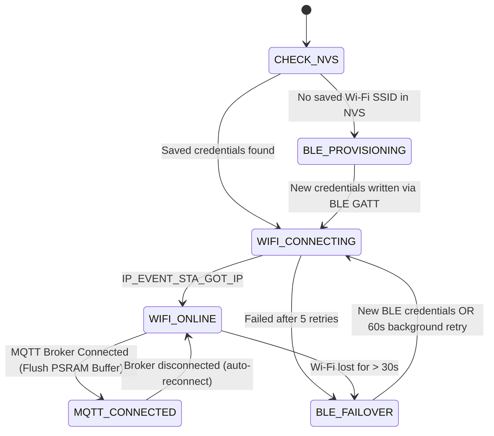

# 03 — W.A.S.T.E. Connectivity: BLE Setup/Failover & MQTT Protocol

## 1. Network Lifecycle & Automatic BLE Failover

**W.A.S.T.E.** (**Waste Automation and Sensing Technology Engine**) uses a unified **Network Manager** that coordinates **Wi-Fi STA**, **NimBLE (Bluetooth Low Energy)**, and **MQTT (`esp-mqtt`)**:



---

## 2. Bluetooth Low Energy (`NimBLE`) Specification

### 2.1 Why `NimBLE` on ESP-IDF `^6.1`
- Uses $< 50\%$ of the RAM required by Bluedroid and integrates cleanly with ESP32-S3 Octal PSRAM (`CONFIG_BT_NIMBLE_ENABLED=y`).
- Active in two scenarios:
  1. **Initial Setup**: First boot when NVS (`net_cfg` namespace) has no Wi-Fi credentials.
  2. **Wi-Fi Failover**: Automatically starts advertising (`SmartBin-S3-XXXX`) whenever Wi-Fi fails to connect after 5 attempts or stays disconnected for $> 30\text{ seconds}$.

### 2.2 BLE GATT Custom Service (`UUID: 0xFF00` / 128-bit UUID)
Provides both **Configuration (Provisioning)** and **Live Offline Telemetry**:

| Characteristic | UUID Offset | Properties | Format / Purpose |
| :--- | :--- | :--- | :--- |
| **Wi-Fi SSID** | `0xFF01` | `Read`, `Write` | UTF-8 string (max 32 bytes) — stored in NVS |
| **Wi-Fi Password** | `0xFF02` | `Write` | UTF-8 string (max 64 bytes) — stored in NVS |
| **MQTT Broker URI** | `0xFF03` | `Read`, `Write` | UTF-8 string (e.g. `mqtt://192.168.1.10:1883`) — stored in NVS |
| **Apply & Connect** | `0xFF04` | `Write` | Write `0x01` to save to NVS and trigger immediate Wi-Fi connection attempt |
| **Live Bin Telemetry** | `0xFF05` | `Read`, `Notify` | JSON (`fill_percent`, `distance_cm`, `lid_state`, `open_cycles`) so the user's phone can monitor the trash bin over BLE even when Wi-Fi is down! |
| **Remote Command JSON** | `0xFF06` | `Write` | Accepts the same JSON command payloads as `smartbin/<id>/cmd` (`open_lid`, `measure_now`, `configure`) directly over BLE! |

---

## 3. MQTT Telemetry Protocol (`esp-mqtt`)

### 3.1 Topic Hierarchy
Using `<device_id>` derived from the ESP32-S3 factory MAC address (e.g., `smartbin_s3_a1b2c3`):

| Topic | Direction | QoS | Retain | Description |
| :--- | :--- | :--- | :--- | :--- |
| `smartbin/<device_id>/telemetry` | Publish | `1` | `false` | Published after every lid close measurement and every periodic ultrasonic check |
| `smartbin/<device_id>/alert` | Publish | `1` | `true` | Published when `fill_percent >= 95%` (cleared when emptied `< 20%`) |
| `smartbin/<device_id>/status` | Publish / LWT | `1` | `true` | `"online"` on connect; Last Will & Testament (LWT) `"offline"` on unexpected drop |
| `smartbin/<device_id>/cmd` | Subscribe | `1` | `false` | Remote JSON commands (open lid, measure now, calibrate, set periodic interval) |

### 3.2 Telemetry JSON Payload (`smartbin/<device_id>/telemetry`)
Built using the `espressif/cjson` managed component:
```json
{
  "device_id": "smartbin_s3_a1b2c3",
  "trigger": "lid_close",
  "fill_percent": 75,
  "distance_cm": 15.0,
  "full_alert": false,
  "lid_state": "closed",
  "open_cycles": 42,
  "wifi_rssi": -58,
  "uptime_s": 3600
}
```
- `"trigger"` values: `"lid_close"`, `"periodic"`, `"remote_cmd"`, or `"boot"`.

### 3.3 Remote Command JSON Payloads (`smartbin/<device_id>/cmd`)
- **Trigger immediate ultrasonic measurement**:
  ```json
  {"cmd": "measure_now"}
  ```
- **Remote lid open**:
  ```json
  {"cmd": "open_lid", "hold_s": 5}
  ```
- **Update calibration or periodic timer interval (persisted to NVS)**:
  ```json
  {
    "cmd": "configure",
    "full_cm": 10.0,
    "empty_cm": 30.0,
    "periodic_interval_s": 900,
    "oled_mode": "always_on"
  }
  ```

---

## 4. Offline Telemetry Ring Buffer (PSRAM)
- When Wi-Fi or the MQTT broker is unreachable during a lid-close event or periodic check:
  1. `open_cycles` is incremented and committed to `NVS` (`nvs_flash`).
  2. Up to **256 telemetry records** are queued in a ring buffer allocated in the **8 MB Octal PSRAM**.
  3. As soon as `MQTT_EVENT_CONNECTED` fires, queued records are published in chronological order before normal operation resumes.
