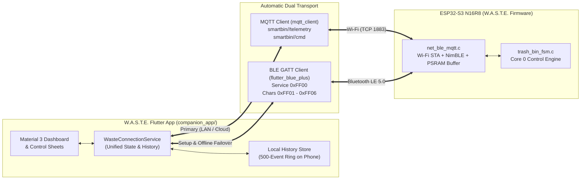

# 06 — W.A.S.T.E. Flutter Companion App (`companion_app/`)

## 1. Overview & Purpose

The **W.A.S.T.E. Companion App** is a cross-platform **Flutter** mobile application (targeting **Android** and **iOS**) located in [`companion_app/`](../companion_app/) inside the monorepo.

It serves four core roles in the **W.A.S.T.E.** (*Waste Automation and Sensing Technology Engine*) ecosystem:
1. **Zero-Touch BLE Provisioning (`NimBLE` `0xFF00`)**: Scans for nearby `smartbin_s3_*` nodes and provisions Wi-Fi SSID, Wi-Fi Password, and MQTT Broker URI directly into the ESP32-S3's NVS flash without recompiling firmware.
2. **Dual-Transport Live Dashboard (MQTT + BLE Failover)**: Streams real-time fill percentage, ultrasonic distance, lid state, and cycle counts over **MQTT** when online—and seamlessly falls back to **BLE GATT Notifications (`0xFF05`)** when Wi-Fi is unreachable.
3. **Remote Actuation & Sensor Calibration**: Sends instant JSON commands (`open_lid`, `measure_now`, `configure`) over either **MQTT (`smartbin/<id>/cmd`)** or **BLE GATT (`0xFF06`)**.
4. **Off-Device Telemetry History & Trend Analytics**: Persists incoming telemetry records locally on the phone (`SharedPreferences` / JSON export), providing historical fill-rate charts without wearing out the ESP32-S3's internal NOR flash.

---

## 2. Dual-Transport Architecture



---

## 3. Protocol Integration Matrix

### 3.1 BLE GATT Service (`0xFF00`)
Used during initial setup and whenever Wi-Fi is offline:

| Characteristic UUID | Direction | Flutter Action | Firmware Handler ([`net_ble_mqtt.c`](../main/net_ble_mqtt.c)) |
| :--- | :--- | :--- | :--- |
| **`0xFF01`** | `Read` / `Write` | Read current SSID or write new Wi-Fi SSID | Reads/writes `cfg->wifi_ssid` |
| **`0xFF02`** | `Write` | Write Wi-Fi WPA2 password | Writes `cfg->wifi_pass` |
| **`0xFF03`** | `Read` / `Write` | Read/write MQTT Broker URI (`mqtt://host:1883`) | Reads/writes `cfg->mqtt_uri` |
| **`0xFF04`** | `Write` | Write `[0x01]` to commit NVS & connect Wi-Fi | Calls `app_config_save()` + `wifi_attempt_connect()` |
| **`0xFF05`** | `Read` / `Notify` | Subscribe to live JSON telemetry over BLE | Pushes `s_latest_telem_json` on every sensor check |
| **`0xFF06`** | `Write` | Send remote JSON command (`open_lid`, `measure_now`, `configure`) | Invokes `handle_mqtt_cmd_payload()` directly over BLE |

### 3.2 MQTT Topics (`smartbin/<device_id>/*`)
Used during normal Wi-Fi operation (supports wildcard `smartbin/+/telemetry` auto-discovery or explicit `<device_id>`):

| Topic | Direction | Flutter Action |
| :--- | :--- | :--- |
| `smartbin/<id>/telemetry` | Subscribe (`QoS 1`) | Updates live gauge, stats cards, and appends to phone history chart |
| `smartbin/<id>/alert` | Subscribe (`Retained`) | Triggers high-visibility **Bin Full ($\ge 95\%$)** banner |
| `smartbin/<id>/status` | Subscribe (`Retained`) | Shows real-time node LWT status (`online` / `offline`) |
| `smartbin/<id>/cmd` | Publish (`QoS 1`) | Sends `open_lid`, `measure_now`, and `configure` JSON payloads |

---

## 4. App Structure (`companion_app/`)

```text
companion_app/
├── pubspec.yaml                              # Flutter dependencies (mqtt_client, flutter_blue_plus, fl_chart, etc.)
├── android/
│   └── app/src/main/AndroidManifest.xml      # BLE (Android 12+ BLUETOOTH_SCAN/CONNECT) & Internet permissions
└── lib/
    ├── main.dart                             # App entrypoint & W.A.S.T.E. Dark Material 3 theme
    ├── models/
    │   └── telemetry.dart                    # WasteTelemetry & WasteConfig JSON models
    ├── services/
    │   └── waste_connection_service.dart     # Unified MQTT + BLE GATT client & local history manager
    └── screens/
        ├── dashboard_screen.dart             # Main fill gauge, telemetry cards, trend chart & quick actions
        ├── ble_provision_sheet.dart          # BLE scanner, direct connect & Wi-Fi/MQTT NVS provisioning
        └── calibration_sheet.dart            # Ultrasonic depth (10-30cm), timer & OLED sleep configuration
```

---

## 5. Building & Running the Companion App

### Option 1 — Download Pre-Built APK from GitHub Actions
Every push to `main` automatically builds **`waste-companion-release.apk`** in GitHub Actions alongside the ESP32-S3 firmware binary.
1. Open the **[GitHub Actions](https://github.com/ASCENDINGHeat/esp-trash-bin/actions)** tab.
2. Download the **`waste-companion-apk`** artifact and install `app-release.apk` on your Android phone.

### Option 2 — Build Locally with Flutter SDK
```bash
cd companion_app
flutter pub get
flutter build apk --release
# Output: build/app/outputs/flutter-apk/app-release.apk
```
