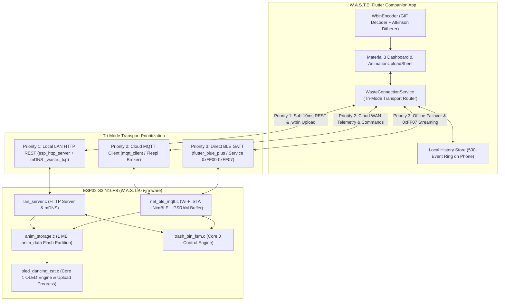

# 06 — W.A.S.T.E. Flutter Companion App (`companion_app/`) — v2.0.0

## 1. Overview & Purpose

The **W.A.S.T.E. Companion App** is a cross-platform **Flutter** mobile application (targeting **Android** and **iOS**) located in [`companion_app/`](../companion_app/) inside the monorepo.

In **v2.0.0**, the app expands beyond dual-transport monitoring into a comprehensive IoT hub with local network discovery and client-side media transcoding:
1. **Tri-Mode Connection Router (`WasteConnectionService`)**: Automatically resolves and connects across three communication channels: **Priority 1 (Local LAN)** $\rightarrow$ **Priority 2 (Cloud MQTT)** $\rightarrow$ **Priority 3 (Direct BLE GATT)**.
2. **In-App GIF to `.wbin` Converter (`WbinEncoder`)**: Transcodes user-selected `.gif` files into validated $128 \times 64$ monochrome animations using pure-Dart box downsampling, Atkinson 1-bit error-diffusion dithering, and IEEE 802.3 CRC32 container packing without external C bindings or server dependencies.
3. **Live Virtual OLED Preview & Animation Uploader (`AnimationUploadSheet`)**: Real-time 1-bit canvas preview (`OledCanvasPainter`), frame scrub slider, playback controls, live upload progress bar, and 1-tap "Reset to Mascot" action.
4. **Zero-Touch BLE Provisioning (`NimBLE` `0xFF00`)**: Scans for nearby `smartbin_s3_*` nodes and provisions Wi-Fi SSID, Wi-Fi Password, and MQTT Broker URI directly into the ESP32-S3's NVS flash without recompiling firmware.
5. **Multi-Transport Remote Actuation & Sensor Calibration**: Sends instant JSON commands (`open_lid`, `measure_now`, `configure`, `reset_anim`) over **Local LAN HTTP**, **Cloud MQTT**, or **BLE GATT**.
6. **Off-Device Telemetry History & Trend Analytics**: Persists incoming telemetry records locally on the phone (`SharedPreferences`), providing historical fill-rate charts without wearing out the ESP32-S3's internal NOR flash.

---

## 2. Tri-Mode Transport Architecture



---

## 3. Protocol Integration Matrix

### 3.1 BLE GATT Service (`0xFF00`)
Used during initial setup, whenever Wi-Fi/MQTT is offline, or when triggered by pressing **`BOOT` (`GPIO 0`)**:

| Characteristic UUID | Direction | Flutter Action | Firmware Handler ([`net_ble_mqtt.c`](../main/net_ble_mqtt.c)) |
| :--- | :--- | :--- | :--- |
| **`0xFF01`** | `Read` / `Write` | Read current SSID or write new Wi-Fi SSID | Reads/writes `cfg->wifi_ssid` |
| **`0xFF02`** | `Write` | Write Wi-Fi WPA2 password | Writes `cfg->wifi_pass` |
| **`0xFF03`** | `Read` / `Write` | Read/write MQTT Broker URI (`mqtt://<TOKEN>@mqtt.flespi.io:1883`) | Reads/writes `cfg->mqtt_uri` |
| **`0xFF04`** | `Write` | Write `[0x01]` to commit NVS & connect Wi-Fi | Calls `app_config_save()` + `wifi_attempt_connect()` |
| **`0xFF05`** | `Read` / `Notify` | Subscribe to live JSON telemetry over BLE | Pushes `s_latest_telem_json` on every sensor check |
| **`0xFF06`** | `Write` | Send remote JSON command (`open_lid`, `measure_now`, `configure`, `ble_provision`, `reset_wifi`, `reset_anim`) | Invokes `handle_mqtt_cmd_payload()` directly over BLE |
| **`0xFF07`** | `Write` / `Write Without Response` | Stream 244-byte `.wbin` animation chunks with live progress tracking | Reassembles stream in PSRAM staging buffer, displays live OLED progress HUD, validates CRC32, and commits to `anim_data` partition |

### 3.2 MQTT Topics (`smartbin/<device_id>/*`)
Used during normal Wi-Fi operation (supports wildcard `smartbin/+/telemetry` auto-discovery or explicit `<device_id>`):

| Topic | Direction | Flutter Action |
| :--- | :--- | :--- |
| `smartbin/<id>/telemetry` | Subscribe (`QoS 1`) | Updates live gauge, stats cards, and appends to phone history chart |
| `smartbin/<id>/alert` | Subscribe (`Retained`) | Triggers high-visibility **Bin Full ($\ge 95\%$)** banner |
| `smartbin/<id>/status` | Subscribe (`Retained`) | Shows real-time node LWT status (`online` / `offline`) |
| `smartbin/<id>/cmd` | Publish (`QoS 1`) | Sends `open_lid`, `measure_now`, `configure`, `fetch_anim`, `reset_anim`, and `reset_wifi` JSON payloads |

### 3.3 Local LAN HTTP REST & mDNS Protocol
When the mobile device is on the same local Wi-Fi subnet as the W.A.S.T.E. receptacle, `WasteConnectionService` routes operations through the embedded HTTP server:

| Endpoint | Method | Companion App Action |
| :--- | :--- | :--- |
| **`_waste._tcp`** | `mDNS` | Resolves `smartbin_s3_<mac>.local` to IP without manual configuration |
| **`/api/status`** | `GET` | Polls live fill level, distance, lid state, cycle count, and custom animation status |
| **`/api/oled/upload`** | `POST` | High-speed binary `.wbin` stream upload in $< 0.3\text{ seconds}$ |
| **`/api/oled/reset`** | `POST` | Restores default Hololive Risu / Dancing Cat mascot animation |
| **`/api/lid`** | `POST` | Actuates lid servo: `{"action":"open"}` or `{"action":"close"}` |
| **`/api/measure`** | `POST` | Triggers immediate ultrasonic measurement ping |
| **`/api/config`** | `POST` | Calibrates bin depths and OLED HUD display mode |

---

## 4. In-App GIF to `.wbin` Converter (`WbinEncoder`) & Atkinson Dithering

Rather than requiring a PC or CLI script to format custom OLED animations, the Flutter Companion App includes a pure-Dart transcoding engine in [`lib/services/wbin_encoder.dart`](../companion_app/lib/services/wbin_encoder.dart):


### 4.1 Atkinson Error Diffusion Dithering Algorithm
To preserve fine image details, cloth folds, and facial expressions on a 1-bit $128 \times 64$ monochrome OLED display, `WbinEncoder` implements the classic Bill Atkinson dithering algorithm. For each pixel:

1. **Luminance Calculation & Gamma Boost**:
   $$\text{gray} = 0.299 R + 0.587 G + 0.114 B$$
   $$\text{boosted} = 255 \times \left(\frac{\text{gray}}{255}\right)^{0.85}$$
2. **1-Bit Quantization** (threshold $T = 118$):
   $$\text{newPixel} = \begin{cases} 255 & \text{if } \text{boosted} \ge T \\ 0 & \text{otherwise} \end{cases}$$
3. **Error Distribution**:
   The quantization error $\Delta = \text{boosted} - \text{newPixel}$ is diffused to 6 neighboring pixels in fractions of $\frac{1}{8}$ (retaining $\frac{2}{8}$ of the error to avoid muddy noise patterns):
   - $(x+1, y) \mathrel{+}= \frac{\Delta}{8}$
   - $(x+2, y) \mathrel{+}= \frac{\Delta}{8}$
   - $(x-1, y+1) \mathrel{+}= \frac{\Delta}{8}$
   - $(x, y+1) \mathrel{+}= \frac{\Delta}{8}$
   - $(x+1, y+1) \mathrel{+}= \frac{\Delta}{8}$
   - $(x, y+2) \mathrel{+}= \frac{\Delta}{8}$

### 4.2 SSD1306 Page Buffer Format ($1024\text{ Bytes/Frame}$)
Monochrome OLED controllers address display memory in vertical 8-pixel pages. For each column $x \in [0, 127]$ within page $p \in [0, 7]$:
$$\text{byte} = \sum_{b=0}^{7} (\text{pixel}(x, p \times 8 + b) \ll b)$$
Where bit 0 represents the top pixel of the 8-pixel vertical stripe.

### 4.3 Container Layout & CRC32 Verification
The generated frame bytes are wrapped in a 16-byte `WGF1` header:
```dart
// 16-byte WGF1 Container Header
ByteData(16)
  ..setUint8(0, 0x57)  // 'W'
  ..setUint8(1, 0x47)  // 'G'
  ..setUint8(2, 0x46)  // 'F'
  ..setUint8(3, 0x31)  // '1'
  ..setUint16(4, numFrames, Endian.little)
  ..setUint8(6, targetFps)
  ..setUint8(7, flags) // bit 0: invert, bit 1: hud_overlay
  ..setUint32(8, payloadBytes, Endian.little)
  ..setUint32(12, crc32, Endian.little);
```
CRC32 is computed using the standard IEEE 802.3 polynomial `0xEDB88320` over the payload bytes only, matching the ESP32-S3 firmware ROM calculation.

---

## 5. Animation Upload Sheet UI (`AnimationUploadSheet`)

Tapping the **OLED Filmstrip Icon** in the `DashboardScreen` AppBar opens the `AnimationUploadSheet` modal:

```text
+------------------------------------------+
|  CUSTOM OLED ANIMATION (.wbin)       [X] |
+------------------------------------------+
|  +------------------------------------+  |
|  |       [ Virtual 128x64 OLED ]      |  |  <- OledCanvasPainter (1-bit SSD1306)
|  |       (Live Monochromatic Preview) |  |
|  +------------------------------------+  |
|  Frame: 14 / 85       [<<] [ > ] [>>]    |  <- Play/Pause & Scrub Controls
|  [================|..................]   |  <- Frame Scrub Slider
|                                          |
|  Target FPS: ( 15 FPS )   [v] Invert B/W |  <- Encoding Controls
|  Route: [ LAN (Sub-second HTTP) ]        |  <- Dynamic Transport Badge
|  [ UPLOAD ANIMATION TO RECEPTACLE ]      |  <- Primary Upload Action
|  [##########................]  42%       |  <- Live Upload Progress Bar
|                                          |
|  [ Reset to Mascot (Dancing Cat) ]       |  <- Mascot Fallback Action
+------------------------------------------+
```

### UI Features & Capabilities:
- **Zero-Lag Monochromatic Canvas (`OledCanvasPainter`)**: Directly renders the raw 1024-byte SSD1306 page buffer onto a Flutter `CustomPaint` canvas, guaranteeing 100% pixel-accurate simulation of the physical OLED screen.
- **Interactive Playback & Scrubbing**: Scrub through all decoded frames with a slider or play them back at the selected target frame rate.
- **Dynamic Transport Route Badge**: Shows whether the upload will proceed over high-speed **LAN HTTP** (green badge, $\sim 0.25\text{ s}$) or routerless **BLE GATT `0xFF07`** (blue badge, $\sim 4.5\text{ s}$).
- **Reset to Mascot Action**: Invokes `/api/oled/reset` (or `reset_anim` over MQTT/BLE) to erase custom flash storage and immediately restore the built-in mascot.

---

## 6. App Structure (`companion_app/`)

```text
companion_app/
├── pubspec.yaml                              # Version 2.0.0+4, dependencies (http, image, file_picker, etc.)
├── android/
│   └── app/src/main/AndroidManifest.xml      # BLE (Android 12+ BLUETOOTH_SCAN/CONNECT) & Internet permissions
├── lib/
│   ├── main.dart                             # App entrypoint & W.A.S.T.E. Dark Material 3 theme
│   ├── models/
│   │   └── telemetry.dart                    # WasteTelemetry & WasteBinConfig models (with oled_ui_mode)
│   ├── services/
│   │   ├── waste_connection_service.dart     # Tri-Mode Router (Priority 1 LAN -> Priority 2 MQTT -> Priority 3 BLE)
│   │   └── wbin_encoder.dart                 # Pure-Dart GIF decoder, Atkinson ditherer, WGF1 packing & CRC32
│   └── screens/
│       ├── dashboard_screen.dart             # Main fill gauge, telemetry cards, trend chart & custom anim launcher
│       ├── animation_upload_sheet.dart       # Virtual OLED preview canvas, frame scrubbing & upload modal
│       ├── ble_provision_sheet.dart          # BLE scanner, Flespi preset & Wi-Fi/MQTT NVS provisioning
│       └── calibration_sheet.dart            # Ultrasonic depth (10-30cm), timer & OLED HUD idle selector
└── test/
    └── widget_test.dart                      # Comprehensive automated test suite (16 tests across 7 groups)
```

---

## 7. Installing & Building the Companion App (`v2.0.0`)

### Option 1 — Download Pre-Built APK from GitHub Releases (`v2.0.0`)
1. Open the **[GitHub Releases (`v2.0.0`)](https://github.com/ASCENDINGHeat/waste-trash-bin/releases/tag/v2.0.0)** page (or the **[Build Companion App workflow](https://github.com/ASCENDINGHeat/waste-trash-bin/actions/workflows/build-app.yml)**).
2. Download **`waste-companion-v2.0.0.apk`** and install it on your Android device.

### Option 2 — Persistent Release Signing & In-Place Updates
All release APKs share the same **Application ID** (`com.ascendingheat.waste.waste_companion`), an increasing **`versionCode`** in [`pubspec.yaml`](../companion_app/pubspec.yaml), and the same persistent release keystore configured via [`configure_android_signing.mjs`](../companion_app/scripts/configure_android_signing.mjs).

### Option 3 — Run Tests & Build Locally with Flutter SDK
```bash
cd companion_app
flutter create --platforms=android --org com.ascendingheat.waste --project-name waste_companion .
node scripts/configure_android_signing.mjs
flutter pub get
flutter test
flutter build apk --release
# Output: build/app/outputs/flutter-apk/app-release.apk
```

---

## 8. Automated Test Suite (`test/widget_test.dart`)

The test suite in `companion_app/test/widget_test.dart` contains **16 automated tests across 7 test groups**:

1. **Group 1 — Model Parsing & Validation**: Tests `WasteTelemetry.fromJson` field extraction and boundary clamping ($0\dots 100\%$, $10\dots 30\text{ cm}$).
2. **Group 2 — Configuration Serialization**: Tests `WasteBinConfig` serialization including `oled_sleep_timeout_s` and `oled_ui_mode`.
3. **Group 3 — Telemetry History Persistence**: Validates 500-event FIFO eviction in `SharedPreferences`.
4. **Group 4 — UI Widget Rendering**: Tests dashboard gauge, alert banners, and telemetry metric cards.
5. **Group 5 — `.wbin` (`WGF1`) Container & IEEE 802.3 CRC32 Tests**:
   - Validates IEEE 802.3 CRC32 oracle test vector (`"123456789"` $\rightarrow$ `0xCBF43926`).
   - Validates 16-byte `WGF1` header packing, field offsets, and little-endian byte ordering.
   - Tests SSD1306 vertical page bit-packing geometry ($128 \times 64 = 1024\text{ bytes}$).
   - Verifies rejection of frame overflow ($> 512$ frames), corrupted CRC32, and truncated payloads.
6. **Group 6 — Tri-Mode Transport Router & Priority Fallback Tests**:
   - Confirms Priority 1 LAN precedence when LAN is connected.
   - Validates automatic fallback to Priority 2 MQTT when LAN disconnects.
   - Validates automatic fallback to Priority 3 BLE GATT when Wi-Fi/MQTT is offline.
   - Tests command dispatch routing across transports.
7. **Group 7 — AnimationUploadSheet & UI Integration Tests**:
   - Tests AppBar launcher button and bottom sheet modal presentation.
   - Tests virtual OLED screen preview rendering and frame scrub slider interactions.
   - Validates dynamic transport routing badges and "Reset to Mascot" triggers.
