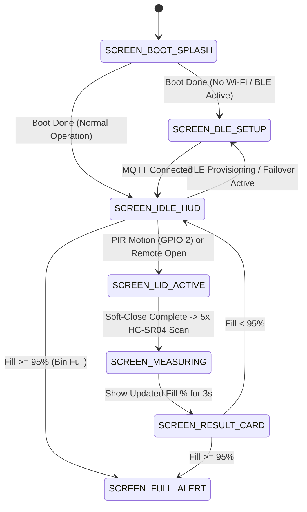
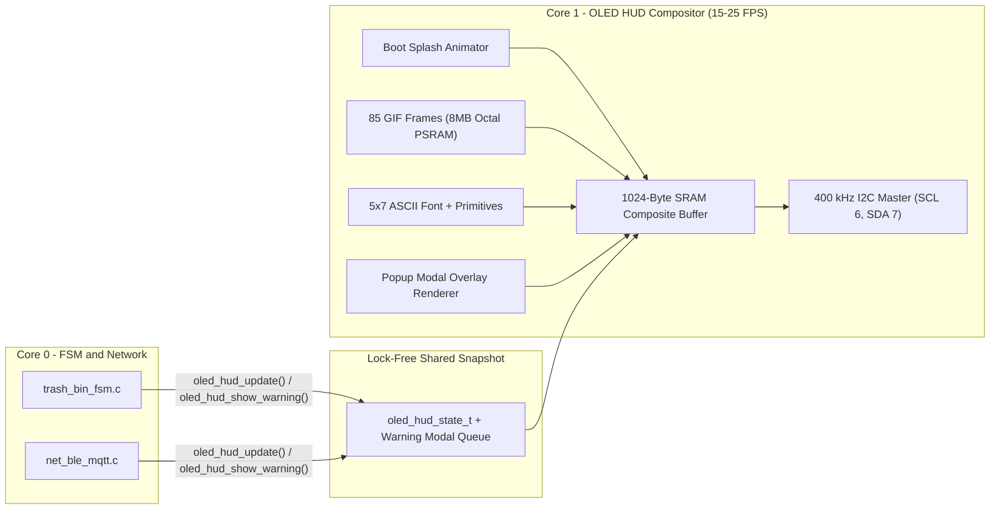

# 07 — W.A.S.T.E. Smart OLED HUD, Boot Animation & Warning Modal Specification (`Core 1`)

> [!NOTE]
> This document specifies the upgrade of the **Core 1** $128 \times 64$ I2C OLED engine (`SCL = GPIO 6`, `SDA = GPIO 7`) from a standalone GIF loop into a **Context-Aware Smart HUD (Heads-Up Display), Boot Splash Animator & Popup Warning Modal Compositor**.

---

## 1. Design Goals

While streaming the 85-frame **Hololive Risu / Dancing Cat** animation from the **8 MB Octal PSRAM** showcases the ESP32-S3's dual-core capability, a production smart receptacle screen should provide **immediate, actionable physical feedback** to anyone standing in front of the bin—without requiring them to open the mobile app or serial monitor:

1. **Animated Boot & Hardware Self-Test (`SCREEN_BOOT_SPLASH`)**: Greet the user at power-on with a smooth **W.A.S.T.E.** logo reveal, live subsystem checklist (`PSRAM`, `Sensors`, `BLE/Wi-Fi`), and node ID readout.
2. **At-a-Glance Fill & Connectivity HUD**: Always show current fill percentage (`0–100%`), ultrasonic headspace (`cm`), lid cycle counter, and network mode (`Wi-Fi/MQTT` vs `BLE Setup`).
3. **Event-Driven Screen Transitions**: Automatically switch from the idle mascot/HUD view to dedicated **Lid Open Countdown**, **Ultrasonic Scanning Progress**, **BLE Onboarding**, or **Full-Bin Alert** screens based on real-time FSM events.
4. **Centered Warning Popup Modals (`MODAL_WARNING_POPUP`)**: Render a floating, drop-shadowed modal window **over** the active screen for transient warnings (e.g., `85% Near Full`, `30s PIR Stuck Timeout`, `HC-SR04 Echo Error`, `Wi-Fi Failover`, or `NVS Reset`).
5. **Zero Core 0 Blocking**: Keep all font rasterization, modal compositing, and PSRAM frame blitting exclusively on **Xtensa LX7 `Core 1`** via a lock-free shared state snapshot (`oled_hud_state_t`).

---

## 2. Display Geometry & Page Memory Map ($128 \times 64$)

The `SSD1306` / `SH1106` GDDRAM ($1024\text{ bytes}$ per frame) is organized into **8 horizontal pages (`Page 0`–`Page 7`)**, each $128\text{ columns wide} \times 8\text{ pixels high}$:

| Page(s) | Pixel Rows ($y$) | Region Name | Content |
| :--- | :--- | :--- | :--- |
| **`Page 0`** | $y = 0..7$ | **Top Status Bar** | Network badge (`MQTT` / `BLE` / `OFFLINE`), Lid state (`IDLE` / `OPEN`), Fill `[ 75% ]` |
| **`Pages 1–6`** | $y = 8..55$ | **Main Viewport ($128 \times 48$)** | Context-switched view: Boot Splash, Mascot + HUD, Split Gauge, Lid Countdown, Radar Scan, or Alert |
| **`Page 7`** | $y = 56..63$ | **Bottom Telemetry Bar** | Ultrasonic depth (`15.0cm`), Open cycles (`#0042`), Wi-Fi RSSI (`-58dBm`) |
| **Overlay Layer** | $x = 8..119$, $y = 10..53$ | **Warning Popup Modal** | Floating $112 \times 44\text{ px}$ modal dialog box with inverted title bar & drop shadow |

---

## 3. Context-Aware Screen Modes & Wireframes

The **Core 1** compositor automatically selects the active base screen mode and composites any active **Warning Popup Modal** on top:



### 3.1 Mode 0 — Boot Splash Animation & POST Checklist (`SCREEN_BOOT_SPLASH`)
Runs automatically for $\sim 1.8\text{ seconds}$ (`27 frames` @ 15 FPS) when the ESP32-S3 powers on:
- **Frames 0–8 (`0.0–0.5s`)**: Horizontal center-outward scanline wipe reveals the $2\times$ bold **`W.A.S.T.E.`** logo and version badge (`v1.0.0`).
- **Frames 9–20 (`0.5–1.3s`)**: Sequential Power-On Self-Test (POST) lines appear with an animated progress bar (`0% -> 100%`):
  - `[OK] 8MB Octal PSRAM (85 Frames)`
  - `[OK] HC-SR04 + SG90 + PIR Ready`
  - `[OK] NimBLE 0xFF00 + Wi-Fi STA`
- **Frames 21–27 (`1.3–1.8s`)**: Displays the unique MAC-derived device ID (`ID: smartbin_s3_a1b2c3`) before transitioning into `SCREEN_IDLE_HUD`.

```text
+------------------------------------------+
|         === W.A.S.T.E. v1.0 ===          |  <- Page 0 (Inverted Title Banner)
+------------------------------------------+
|  [OK] 8MB Octal PSRAM (85 Frames)        |
|  [OK] HC-SR04 + SG90 + PIR Ready         |  <- Animated POST Checklist
|  [OK] NimBLE 0xFF00 + Wi-Fi STA          |
|  ID:  smartbin_s3_a1b2c3                 |
+------------------------------------------+
| BOOTING [##################..]       92% |  <- Page 7: Smooth Progress Bar
+------------------------------------------+
```

### 3.2 Mode 1 — Idle HUD + Mascot Overlay (`SCREEN_IDLE_HUD`)
When the bin is closed and normal (`fill_percent < 95%`), **Core 1** composites the top and bottom telemetry bars over the 85-frame PSRAM animation (or displays a side-by-side Split Gauge):

```text
+------------------------------------------+
| MQTT -58dB      [IDLE]        Fill:  42% |  <- Page 0 (y=0..7): Status Bar
+------------------------------------------+
|                                          |
|        ( 85-Frame Risu Animation         |
|          or Split Fill Bar Gauge )       |  <- Pages 1..6 (y=8..55): Viewport
|                                          |
+------------------------------------------+
| Dist: 21.6cm    ||||||||..    Cycles: 42 |  <- Page 7 (y=56..63): Telemetry Footer
+------------------------------------------+
```
* **Selectable Idle Sub-Styles** (configurable via MQTT/BLE `oled_ui_mode`):
  - `"hud_mascot"` *(Default)*: Full-frame Risu animation with masked top (`Page 0`) and bottom (`Page 7`) HUD bars.
  - `"split_dashboard"`: Left $64 \times 48$ animated mascot + Right $64 \times 48$ large $2\times$ font `42%` and vertical bin fill bar.
  - `"mascot_only"`: Pure 100% full-screen GIF animation during idle, waking the HUD overlay only when motion or state changes occur.

### 3.3 Mode 2 — Active Lid & Hold Countdown (`SCREEN_LID_ACTIVE`)
Triggered immediately when `LID_STATE_OPENING`, `LID_STATE_OPEN_HOLD`, or `LID_STATE_CLOSING` is active:

```text
+------------------------------------------+
| MQTT            [OPEN]        Fill:  42% |  <- Page 0
+------------------------------------------+
|                                          |
|            >>> LID OPEN <<<              |  <- 2x Bold Header
|          Hold Time:  2.4 sec             |  <- Live countdown timer
|       [################........]         |  <- Animated countdown bar
|                                          |
+------------------------------------------+
| PIR: MOTION ACTIVE            Cycles: 43 |  <- Page 7
+------------------------------------------+
```
* During `LID_STATE_CLOSING` (`500 ms` soft-close ramp), the center banner transitions to **`<<< SOFT CLOSING >>>`** so the user knows the lid is descending.

### 3.4 Mode 3 — Ultrasonic Scanning & Result Card (`SCREEN_MEASURING`)
Triggered during `LID_STATE_MEASURING` (5-ping median `HC-SR04` burst) and held for `3.0 seconds` afterward:

```text
+------------------------------------------+
| MQTT            [SCAN]        Fill:  75% |  <- Page 0
+------------------------------------------+
|                                          |
|          CAPACITY:   75% FULL            |  <- Large 2x Font Readout
|          Headspace:  15.0 cm             |  <- 5-Ping Median Result
|          [###############.....]          |  <- 0-100% Fill Gauge Bar
|                                          |
+------------------------------------------+
| Trigger: LID_CLOSE            Cycles: 43 |  <- Page 7
+------------------------------------------+
```

### 3.5 Mode 4 — High-Contrast Full-Bin Alert (`SCREEN_FULL_ALERT`)
Triggered automatically whenever `full_alert == true` (`fill_percent >= 95%`, $\le 10\text{ cm}$):

```text
+------------------------------------------+
| ! ALERT !       [FULL]        Fill: 100% |  <- Page 0 (Inverted / Blinking)
+------------------------------------------+
|  ######################################  |
|  ##         ! BIN IS FULL !          ##  |
|  ##      PLEASE EMPTY RECEPTACLE     ##  |  <- High-contrast inverted alert box
|  ##       Depth: 9.8 cm (100%)       ##  |
|  ######################################  |
+------------------------------------------+
| ALERT SENT TO MQTT            Cycles: 50 |  <- Page 7
+------------------------------------------+
```
* Periodically toggles SSD1306 hardware display inversion (`0xA6` $\leftrightarrow$ `0xA7`) at `1 Hz` to catch attention from across the room.

### 3.6 Mode 5 — BLE Provisioning & Onboarding (`SCREEN_BLE_SETUP`)
Triggered when NVS has no Wi-Fi SSID, when Wi-Fi/MQTT enters BLE failover, or when the user presses the onboard **`BOOT` (`GPIO 0`)** button:

```text
+------------------------------------------+
| [BLE SETUP]     0xFF00        No Wi-Fi   |  <- Page 0
+------------------------------------------+
|  BLE Name: smartbin_s3_a1b2c3            |
|  Status:   Advertising (Ready to Pair)   |
|  App:      Open W.A.S.T.E. Companion     |
|            -> Tap Antenna -> Scan BLE    |
+------------------------------------------+
| Hold BOOT 3s = Reset Wi-Fi    Fill:  42% |  <- Page 7
+------------------------------------------+
```

---

## 4. Non-Blocking Warning Popup Modal System (`MODAL_WARNING_POPUP`)

In addition to the 6 base screens above, the **Core 1** compositor supports a **floating Popup Modal Overlay** ($112 \times 44\text{ px}$, centered at $x = 8..119, y = 10..53$) that renders **on top of** the current screen with a cleared background border, inverted header bar, drop shadow, and an auto-dismiss timer bar:

```text
+------------------------------------------+
| MQTT -58dB      [IDLE]        Fill:  88% |  <- Background screen remains visible
+------------------------------------------+
|   +----------------------------------+   |
|   | [!] WARNING: NEAR CAPACITY       |#  |  <- Inverted Modal Title Bar
|   |----------------------------------|#  |
|   | Bin fill level reached 88%       |#  |  <- Modal Message Line 1
|   | Headspace remaining: 12.4 cm     |#  |  <- Modal Message Line 2
|   | [####################........]   |#  |  <- Auto-Dismiss Countdown Bar
|   +----------------------------------+#  |
|    ####################################  |  <- 2px Drop Shadow
+------------------------------------------+
| Dist: 12.4cm    |||||||||.    Cycles: 49 |
+------------------------------------------+
```

### 4.1 Built-In Warning Modal Triggers (`oled_warn_code_t`)

| Warning Code | Trigger Condition | Modal Title | Modal Body Text | Duration |
| :--- | :--- | :--- | :--- | :--- |
| **`OLED_WARN_NEAR_FULL`** | $85\% \le \text{fill\_percent} < 95\%$ after measurement | `[!] NEAR CAPACITY` | `Bin reached XX% full` / `Headspace: XX.X cm` | `4.0 s` |
| **`OLED_WARN_PIR_STUCK_TIMEOUT`** | `HC-SR501` (`GPIO 2`) held HIGH for $> 30\text{ s}$ safety cap | `[!] MOTION TIMEOUT` | `PIR active > 30 sec` / `Force closing lid...` | `3.5 s` |
| **`OLED_WARN_SENSOR_ECHO_ERR`** | All 5 `HC-SR04` pings timed out (`ECHO` `GPIO 18` lost) | `[!] SENSOR ERROR` | `HC-SR04 echo timeout` / `Check TRIG:5 ECHO:18` | `4.5 s` |
| **`OLED_WARN_WIFI_FAILOVER`** | Wi-Fi lost after 5 retries $\rightarrow$ switched to BLE `0xFF00` | `[!] WIFI OFFLINE` | `Switched to BLE Mode` / `Buffering in PSRAM` | `3.5 s` |
| **`OLED_WARN_WIFI_RESET`** | `BOOT` (`GPIO 0`) held $0.8\text{–}3\text{ s}$ (countdown) / $3\text{ s}$ erase / remote `reset_wifi` | `[i] WIFI CLEARED` | `Reset WiFi: X.Xs` countdown or `NVS WiFi cleared` / `BLE Setup Active` | `4.0 s` |
| **`OLED_WARN_BLE_ACTIVE`** | Short press of `BOOT` (`GPIO 0`) button | `[i] BLE & STATUS` | `BLE: SmartBin-S3-XXXX` / `IP:<sta_ip>` or `Ready to Pair!` | `4.0 s` |

---

## 5. Dual-Core Compositor Architecture (`Core 0` $\rightarrow$ `Core 1`)



### 5.1 Shared HUD & Modal API (`oled_dancing_cat.h`)
```c
typedef enum {
    OLED_UI_MODE_HUD_MASCOT = 0,   /* Mascot animation + Top/Bottom HUD bars */
    OLED_UI_MODE_SPLIT_DASHBOARD,  /* 64px Mascot + 64px Large Fill Gauge    */
    OLED_UI_MODE_MASCOT_ONLY       /* Fullscreen GIF when idle, HUD on event */
} oled_ui_mode_t;

typedef enum {
    OLED_WARN_NONE = 0,
    OLED_WARN_NEAR_FULL,           /* 85% - 94% fill warning modal           */
    OLED_WARN_PIR_STUCK_TIMEOUT,   /* 30s PIR stuck-sensor safety close      */
    OLED_WARN_SENSOR_ECHO_ERR,     /* HC-SR04 ultrasonic timeout             */
    OLED_WARN_WIFI_FAILOVER,       /* Wi-Fi disconnected -> BLE failover     */
    OLED_WARN_WIFI_RESET,          /* NVS Wi-Fi credentials cleared          */
    OLED_WARN_BLE_ACTIVE           /* BOOT button pressed -> BLE/status info */
} oled_warn_code_t;

/**
 * @brief Trigger a non-blocking centered warning popup modal over the current screen.
 */
void oled_hud_show_warning(oled_warn_code_t code, const char *line1, const char *line2, uint32_t duration_ms);
```

### 5.2 Multi-Layer Rendering Pipeline on `Core 1`
1. **Layer 0 (Boot Override)**: During the first `1.8 seconds` after boot, renders `SCREEN_BOOT_SPLASH` into `s_composite_fb[1024]`.
2. **Layer 1 (Base Viewport + HUD Bars)**: Copies `oled_hud_state_t` and renders the active screen (`IDLE_HUD`, `LID_ACTIVE`, `MEASURING`, `FULL_ALERT`, or `BLE_SETUP`) into `s_composite_fb[1024]`.
3. **Layer 2 (Popup Warning Modal Overlay)**: If `esp_timer_get_time() < s_modal_expire_us`, clears the $112 \times 44\text{ px}$ center box in `s_composite_fb`, draws the 1-bit border + 2px drop shadow, renders the inverted warning header, draws `line1` / `line2`, and draws the remaining modal duration bar.
4. **I2C Burst Flush**: Transmits the 8 pages (`1024 bytes`) over `400 kHz` I2C (`~22 ms` bus time), sleeping for the remainder of the frame tick via `vTaskDelayUntil()`.

---

## 6. Implemented Firmware & Companion App Integration (`v2.0.0`)

| Component | Implemented Additions | Status |
| :--- | :--- | :--- |
| **`main/oled_font5x7.h`** | Compact `95-glyph` printable ASCII $5 \times 7$ bitmap font (`475 bytes` in Flash) + $1\times / 2\times$ text, progress bar, and drop-shadow modal box drawing helpers. | **Implemented** |
| **`main/oled_dancing_cat.h / .c`** | `SCREEN_BOOT_SPLASH` animator, 5-mode HUD compositor, `oled_hud_show_warning()` popup modal overlay renderer, `s_composite_fb[1024]`, live upload progress bar compositor, and thread-safe mutex buffer swapping on **Core 1**. | **Implemented** |
| **`main/anim_storage.h / .c`** | Flash partition I/O on `anim_data` (`0x310000`, 1 MB), 16-byte `WGF1` header & IEEE 802.3 CRC32 verification, PSRAM dynamic frame caching, and instant mascot fallback. | **Implemented** |
| **`main/trash_bin_fsm.c` & `net_ble_mqtt.c`** | Push live state into `oled_hud_update()`, run Core 0 `boot_btn_task` (`GPIO 0`), and trigger warning modals (`NEAR_FULL`, `PIR_STUCK_TIMEOUT`, `SENSOR_ECHO_ERR`, `WIFI_FAILOVER`, `WIFI_RESET`, `BLE_ACTIVE`). | **Implemented** |
| **`main/lan_server.h / .c`** | Embedded HTTP server (port 80) and mDNS responder (`_waste._tcp`), handling `POST /api/oled/upload` and `POST /api/oled/reset`. | **Implemented** |
| **Companion App (`companion_app/`)** | In-app GIF-to-`.wbin` converter (`WbinEncoder`), Atkinson 1-bit dithering, virtual OLED canvas preview (`OledCanvasPainter`), Tri-Mode `Connection Selector` & LAN UI (`BleProvisionSheet`), multi-device backend (`WasteDeviceSession`), and `AnimationUploadSheet` modal UI. | **Implemented** |

---

## 7. User-Uploadable Custom OLED Animation Engine (`.wbin` Format) — Implemented in `v2.0.0`

The `YD-ESP32-23` (`ESP32-S3 N16R8`) features **16 MB of NOR Flash** and **8 MB of Octal PSRAM**, allowing OLED animations to be updated dynamically at runtime without recompiling or reflashing firmware. Users can upload any custom animation directly from the **W.A.S.T.E. Flutter Companion App** over Local LAN HTTP or BLE GATT.

### 7.1 Client-Side Conversion Architecture
Decoding arbitrary LZW-compressed `.gif` files with variable color palettes and disposal methods on an embedded MCU exhausts heap memory and wastes compute cycles.
Instead:
1. **Phone-Side Transcoding & Live Preview**: The Flutter Companion App decodes `.gif` frames, downsamples them to $128 \times 64$, applies **Atkinson 1-bit error-diffusion dithering** (providing a real-time monochrome preview on the phone screen), and wraps the frames in a validated **`.wbin` (`W.A.S.T.E. Binary Animation`)** container.
2. **Zero-Overhead MCU Streaming & Playback**: The ESP32-S3 receives ready-to-DMA SSD1306 vertical page bytes (`1,024 bytes` per frame), commits them to a dedicated Flash partition (`anim_data`), and caches them into **8 MB Octal PSRAM** for smooth 15–30 FPS playback on Core 1.

### 7.2 `.wbin` (`WGF1`) Binary Container Layout

The `.wbin` container uses a strict 16-byte packed header followed by raw SSD1306 vertical page frame buffers:

```c
#pragma pack(push, 1)
typedef struct {
    char     magic[4];       /* Exact ASCII "WGF1" (0x57, 0x47, 0x46, 0x31) */
    uint16_t num_frames;     /* 1 to 512 frames (max 512 KB payload) */
    uint8_t  target_fps;     /* Playback rate: 5 to 30 FPS (default 15) */
    uint8_t  flags;          /* Bit 0: invert pixels, Bit 1: hud_overlay */
    uint32_t payload_bytes;  /* num_frames * 1024 */
    uint32_t crc32;          /* IEEE 802.3 CRC32 calculated over payload bytes */
} wbin_header_t;
#pragma pack(pop)
```

#### Field Specification:

| Offset | Size | Type | Field | Description |
| :--- | :--- | :--- | :--- | :--- |
| `0x00` | `4 B` | `char[4]` | `magic` | Container identifier: `"WGF1"` (`0x57, 0x47, 0x46, 0x31`) |
| `0x04` | `2 B` | `uint16_t` | `num_frames` | Number of $128 \times 64$ frames ($1 \dots 512$, max `512 KB`) |
| `0x06` | `1 B` | `uint8_t` | `target_fps` | Playback frame rate ($5 \dots 30\text{ FPS}$, clamped if out of range) |
| `0x07` | `1 B` | `uint8_t` | `flags` | Bit 0: `WBIN_FLAG_INVERT` (`0x01`), Bit 1: `WBIN_FLAG_HUD_OVERLAY` (`0x02`) |
| `0x08` | `4 B` | `uint32_t` | `payload_bytes`| Exact payload byte count, must equal $\text{num\_frames} \times 1024$ |
| `0x0C` | `4 B` | `uint32_t` | `crc32` | Standard IEEE 802.3 CRC32 checksum computed over the frame payload |
| `0x10` | $N \times 1024\text{ B}$ | `uint8_t[]` | `frames` | Contiguous SSD1306 vertical page-addressed frame buffers ($8\text{ pages} \times 128\text{ cols}$) |

#### CRC32 Calculation Standard:
- **Polynomial**: `0xEDB88320` (IEEE 802.3 / ITU-T V.42)
- **Initial Value**: `0xFFFFFFFF`
- **Final XOR**: `0xFFFFFFFF`
- **Scope**: Computed strictly over the payload bytes ($0\dots\text{payload\_bytes}-1$), excluding the 16-byte header.

---

### 7.3 Flash Partition Map & Octal PSRAM Caching Architecture

#### 1. Partition Table Layout (`partitions.csv`):
```csv
# Name,     Type, SubType, Offset,   Size,     Flags
nvs,        data, nvs,     0x9000,   0x6000,
phy_init,   data, phy,     0xf000,   0x1000,
factory,    app,  factory, 0x10000,  0x300000,
anim_data,  data, 0x99,    0x310000, 0x100000,
```
- **Geometry & Alignment**:
  - `factory` app partition: 3 MB (`0x300000` bytes) from `0x010000` to `0x310000`.
  - `anim_data` partition: **1 MB (`0x100000` bytes / 1,048,576 bytes)** from `0x310000` to `0x410000`.
  - Start offset `0x310000` is both **64 KB block aligned** (`0x310000 % 0x10000 == 0`) and **4 KB sector aligned** (`0x310000 % 0x1000 == 0`), enabling fast hardware block erases.
  - Leaves $\sim 11.94\text{ MB}$ unallocated flash headroom within 16 MB NOR Flash (`0x1000000`).

#### 2. Dynamic 8 MB Octal PSRAM Caching:
At startup, `anim_storage_load_to_psram()` checks `anim_data`:
- Allocates buffer dynamically in **8 MB Octal PSRAM** via `heap_caps_malloc(payload_bytes, MALLOC_CAP_SPIRAM | MALLOC_CAP_8BIT)` with fallback to internal SRAM.
- Verifies `wbin_header_t` magic, bounds, and computes IEEE 802.3 CRC32 via `esp_rom_crc32_le`.
- Core 1 `oled_anim_task` renders directly from PSRAM with frame delay dynamically calculated from `target_fps` ($\Delta t = \frac{1000}{\text{fps}}\text{ ms}$).

#### 3. Automatic Mascot Fallback:
To guarantee that the OLED display always functions:
- At boot, the 85-frame Hololive Risu / Dancing Cat mascot (`dancing_cat_frames.h`) is pre-rendered into `s_default_psram_buf` in PSRAM.
- If `anim_data` is unprogrammed (`0xFF`), header magic fails, CRC32 mismatches, or the user issues `POST /api/oled/reset`, the active frame pointer `s_psram_frames` instantly switches to the default mascot buffer without performing runtime dynamic allocations.

#### 4. Thread-Safe Cross-Core Mutex Synchronization:
- FreeRTOS mutex `s_anim_mutex` safeguards active animation pointer swaps.
- Network upload tasks (LAN HTTP on Core 0, BLE GATT task, MQTT client) stage uploaded bytes in a temporary staging buffer, verify the complete file and CRC32, acquire `s_anim_mutex`, commit to flash via `anim_storage_save_from_buffer`, and atomically update `s_psram_frames`.
- Core 1 `oled_anim_task` acquires `s_anim_mutex` briefly when advancing frames, eliminating visual tearing and race conditions.

---

### 7.4 Multi-Transport Uploads & Live Upload Progress HUD

Custom animations can be uploaded through three distinct transports:

| Transport | Endpoint / Mechanism | Typical Time (`85 frames` / `85 KB`) | Description |
| :--- | :--- | :--- | :--- |
| **1. Local LAN HTTP** *(Fastest)* | `POST /api/oled/upload` | **`~0.25 s`** | High-bandwidth binary stream directly from Companion App over Wi-Fi LAN; atomic CRC verification and flash write. |
| **2. BLE GATT (`0xFF07`)** *(Routerless)* | Characteristic `0xFF07` (`244B` chunks) | **`~4.5 s`** | Routerless transfer for offline setup. Receives 244-byte chunks with progressive reassembly and real-time OLED HUD feedback. |
| **3. MQTT Remote Fetch** *(Cloud)* | `{"cmd":"fetch_anim","url":"http://..."}` | **`~1.0 s`** | Remote command triggers background `esp_http_client` task to stream `.wbin` from URL into PSRAM and flash. |

#### Live OLED Upload Progress HUD Display
During streaming transfers over any transport, the firmware invokes `oled_hud_set_upload_progress(true, percent, transport_name)`. The Core 1 OLED compositor renders a real-time progress bar overlay:

```text
+------------------------------------------+
| MQTT -58dB      [UPLD]        Fill:  42% |  <- Top status bar
+------------------------------------------+
|                                          |
|         UPLOADING GIF:  68%              |  <- Large bold progress header
|      Route: [ BLE CHUNKS (0xFF07) ]      |  <- Transport badge
|      [###################.......]        |  <- Live linear progress bar
|      Bytes: 59,136 / 87,056 B            |  <- Real-time transfer counter
|                                          |
+------------------------------------------+
| Dist: 21.6cm    ||||||||..    Cycles: 42 |  <- Bottom telemetry bar
+------------------------------------------+
```
- On upload completion or connection abort, `oled_hud_set_upload_progress(false, 0, NULL)` removes the overlay, returning instantly to the active animation view.
